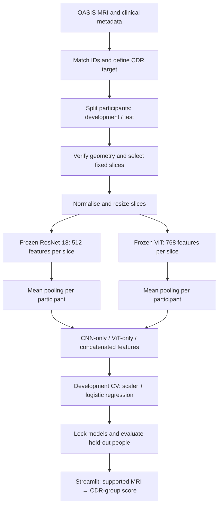

# Complete code and process guide

This document contains the operating guide and the exact source files shipped in the runnable project ZIP. Use the ZIP to run the code; use this document to understand and review it. All training results must be generated on your authorised OASIS-1 data.

## End-to-end architecture



The test branch uses the already-fixed geometry, encoders and classifiers; it never participates in model selection. The age-only baseline is a separate classifier using age, not an extra MRI feature.

## How the code works

| Stage/functions | Meaning and purpose |
|---|---|
| `load_config`, `out` | Resolve configuration and organise outputs consistently |
| `prepare`, `manifest` | Match clinical labels to scans; group by person, save stratified splits and protect the manifest |
| `inspect`, `configure_geometry`, `audit` | Show anatomy, record human-verified geometry, catch corrupted or inconsistent inputs |
| `load_volume`, `slices_array` | Read a paired Analyze/NIfTI volume; validate grid; normalise and extract fixed 2D slices |
| `tensor_inputs` | Preserve aspect ratio with padding, resize, repeat grayscale into RGB, normalise for pretrained encoders |
| `encoder`, `encode` | Load official pretrained weights, remove classification heads, freeze and run inference |
| `extract`, `read_cache` | Save per-slice features with identifiers and fingerprints; resume compatible work |
| `matrix` | Mean-pool selected slices per encoder; concatenate for fusion |
| `train` | Fit scaler/classifier inside CV, tune regularisation, refit and lock protocol |
| `evaluate` | Score unseen participants, generate confusion/ROC plots and bootstrap intervals |
| `benchmark` | Measure actual component and full prediction costs |
| `predict_image`, `verify_prediction` | Apply the same preprocessing/classifier; check cached/live agreement |
| `package_review` | Return reproducible trained outputs without bundling MRI scans |
| `app.py` | Local user interface calling the shared prediction code |

### Numerical example of mean pooling and concatenation

If two CNN slice vectors are `[2,4]` and `[4,8]`, the participant mean is `[3,6]`. If the ViT participant vector is `[1,5,9]`, concatenation gives `[3,6,1,5,9]`. Real vectors have 512 and 768 entries, producing 1,280 fused entries. The number of participants does not increase when more slices are used.

### What learns from our MRI data?

Only the scaler and logistic regression parameters are fitted to this cohort. The two pretrained neural networks remain frozen. During development CV, the classifier learns a relationship between participant image features and the known CDR group. At inference, the MRI alone supplies the image features; the unknown CDR label is not an input. Frozen general-image encoders may not capture enough MRI-specific information; the evaluation determines whether they work adequately for this research task.

### Why each safeguard exists

Participant splitting prevents near-identical slices leaking across sets. Training-fold-only scaling prevents distribution leakage. A locked test set prevents tuning to the answer. Age-only comparison checks a possible shortcut. Geometry checking prevents feeding different anatomy at matching array positions. Version and source fingerprints prevent accidentally combining incompatible feature caches and models. None of these alone proves clinical validity.


---

# Dementia MRI project — training and frontend handoff

**Start here.** This is a runnable research project, not a trained diagnostic product. Your friend supplies the authorised OASIS-1 download. The ZIP contains the pipeline, configuration, frontend, tests and documentation. No OASIS images, trained classifiers or claimed accuracy are included.

## 1. What we are building and why

**Title:** Evaluating CNN–ViT Feature Fusion for MRI-Based Dementia Status Classification.

Input: a supported, brain-masked, atlas-aligned structural MRI. Output: a participant-level prediction of **CDR = 0 versus CDR > 0**, with a model score. CDR comes from the clinical spreadsheet; it is the training target, not an input image feature. This is not confirmation of Alzheimer's disease or a replacement for clinical assessment.

We test whether combining representations from a pretrained CNN and ViT helps compared with either alone. Fusion itself is established work; our contribution is a controlled comparison, including computation and an age-confound baseline. We cannot promise fusion will win.

**Deadline scope:** run `review`: CNN-16, ViT-16, fusion-16 and age-only. Sixteen means 16 two-dimensional cross-sections from each person's 3D MRI. It gives one fixed, manageable protocol. It is not a proven optimum. The optional `full` suite adds 4 and 8 nested slices; do not claim a slice-budget study if you run only `review`.

## 2. Files and hardware

| File | Purpose |
|---|---|
| `pipeline.py` | Preparation, validation, feature extraction, training, evaluation, timing, prediction and return ZIP |
| `app.py` | Local Streamlit frontend using the same preprocessing and saved models |
| `config.yaml` | Paths, MRI geometry, slice selection and experiment settings |
| `requirements.txt` | Non-PyTorch dependencies |
| `requirements-tested.txt` | Versions used for the supplied CPU software checks; not a GPU installation recipe |
| `tests/test_pipeline.py` | Synthetic feature/data tests |
| `tests/smoke_cpu.py` | Synthetic MRI end-to-end CNN and frontend smoke test |
| `HANDOFF_CHECKLIST.md` | What your friend must verify and return |
| `VALIDATION.md` | What was actually checked before delivery |
| `COMPLETE_CODE_GUIDE.md` | This guide plus explanations and all source code |

RTX 3050 and 16 GB system RAM are a reasonable target for frozen extraction. GPU VRAM varies by 3050 model. Start with batch size 2; reduce to 1 on CUDA out-of-memory. Encoders run separately. A GPU accelerates feature extraction; the small logistic-regression classifiers train on CPU. CPU fallback is supported but slower. Runtime depends on disk, GPU, drivers and cohort size; estimate from the pilot rather than promising a duration.

Use 64-bit Python 3.11 or 3.12. The delivered checks use Python 3.12. Keep sufficient free space for your already-extracted OASIS release, Python, model weights and outputs. First use downloads pretrained weights; arrange internet before the review.

## 3. Install (Windows PowerShell)

Extract the ZIP. Open a terminal **inside `dementia_handoff`**. These commands assume Windows; Linux/macOS use `python3 -m venv .venv` and `source .venv/bin/activate` instead.

```powershell
py -3.12 -m venv .venv
.\.venv\Scripts\Activate.ps1
python -m pip install --upgrade pip
```

If PowerShell blocks activation, use Command Prompt and `.venv\Scripts\activate.bat`, or invoke `.venv\Scripts\python.exe` directly. Do not disable system security policies.

Install PyTorch and torchvision together using the command from the [official installation selector](https://pytorch.org/get-started/locally/): choose Windows, Pip, Python and a CUDA build supported by your NVIDIA driver. Run `nvidia-smi` to inspect the GPU/driver. Do not use the CPU wheel command below for the intended GPU run.

If you intentionally want CPU-only:

```powershell
python -m pip install torch torchvision --index-url https://download.pytorch.org/whl/cpu
```

Then install the remaining libraries:

```powershell
python -m pip install -r requirements.txt
python pipeline.py doctor --models
```

**Why:** the doctor records versions, reports CUDA and tests real pretrained CNN/ViT forward passes (512 and 768 output values). On your RTX system it should report CUDA available and the GPU name. If it reports CPU, fix the PyTorch/driver installation before the long run. A locally installed CUDA toolkit is not a substitute for a CUDA-enabled PyTorch build.

Keep this environment unchanged during extraction, training and evaluation. The pipeline detects changed versions and refuses incompatible caches/models. Record the final environment:

```powershell
python -m pip freeze > friend_environment_freeze.txt
```

## 4. Supply the correct OASIS-1 files

Use the original [OASIS-1 release](https://sites.wustl.edu/oasisbrains/home/oasis-1/) under its access agreement. You need:

1. The clinical/demographic table with `ID`, `Age`, `CDR` (CSV, XLSX or XLS).
2. For all intended participants, the processed `PROCESSED/T88_111/` **brain-masked** image product ending `_t88_masked_gfc.hdr`, plus its matching `.img` file.
3. The release documentation, to verify anatomical orientation and image products.

Do not download OASIS-2/3/4 for this implementation. Do not substitute JPG screenshots, Kaggle-repackaged slices, unmasked files or raw repeated acquisitions. Keep `.hdr` and `.img` together with the same filename stem. Extract all intended archives under one root; nested disc directories are supported.

Example (your real filenames may differ):

```text
D:/OASIS1/
  oasis_cross-sectional.xlsx
  disc1/OAS1_0001_MR1/PROCESSED/T88_111/
    OAS1_0001_MR1_mpr_n4_anon_111_t88_masked_gfc.hdr
    OAS1_0001_MR1_mpr_n4_anon_111_t88_masked_gfc.img
```

Edit only the initial path values in `config.yaml` first:

```yaml
data_root: 'D:/OASIS1'
metadata_file: 'D:/OASIS1/oasis_cross-sectional.xlsx'
output_dir: 'outputs'
batch_size: 2
device: auto
experiment_suite: review
```

Use the real metadata filename; it need not be renamed. Forward slashes avoid Windows YAML escape problems. The root must contain extracted files, not only archives.

## 5. Build and inspect the participant table

```powershell
python pipeline.py prepare
```

**What happens:** match image sessions to metadata IDs; retain age >= 60 and recorded CDR in 0, 0.5, 1 or 2; set label 0 for CDR=0 and 1 for CDR>0; keep one earliest eligible session per person; check image pairs and duplicate content; create a fixed stratified 80/20 development/test split and development CV folds.

**Why:** the unit is a person, not a slice. Slices from one person must never appear in both training and testing. Older-adult restriction reduces a simple young-versus-old shortcut, but does not remove all confounding.

Read `outputs/manifests/` including `participants.csv`, exclusions and cohort summary. Check counts for both labels, the number of matched images, and excluded reasons. Missing CDR is not CDR zero. A partial download can silently reduce the research cohort; investigate missing-file exclusions before proceeding. The script requires at least eight participants in each group, but this is a software minimum, not an adequate scientific sample-size claim.

Do not edit the generated participants CSV: it is sealed with a hash. If paths or objective exclusions need changing before experiments, correct configuration, use a new output directory, and run preparation again. Optional exclusions CSV has columns `session_id,reason`; set `exclusion_file` before preparation and document objective reasons, never model performance.

## 6. Verify anatomy and choose the 16 slices — required manual step

```powershell
python pipeline.py inspect
```

Open the `outputs/qc/*_planes.png` and corresponding geometry JSON. The montage shows each array axis at several indices. Choose a development participant from `participants.csv` and inspect additional development examples:

```powershell
python pipeline.py inspect --subject OAS1_0001
```

Replace that example ID with an actual development `subject_id` from your manifest (no `_MR1` suffix). **An array axis number is not automatically an anatomical direction.** Analyze headers may not fully establish orientation. Confirm axial anatomy using release documentation and, if needed, a knowledgeable supervisor/MRI viewer. Inspect several development scans without using their labels to optimise slices. A transverse/axial view is a horizontal cross-section of the head; sagittal is side-on and coronal is front-on.

Choose a consistent brain-containing axial range that samples relevant brain anatomy and avoids near-empty end slices. No universal index range can be safely supplied without seeing your actual image product. The following is a command template: replace all capitalised placeholders; it is not directly runnable as written.

```text
python pipeline.py configure-geometry --subject DEVELOPMENT_ID --axis VERIFIED_AXIS_NUMBER --first FIRST_VOXEL_INDEX --last LAST_VOXEL_INDEX --notes "How orientation and range were verified"
```

**What happens:** the command records measured shape, spacing and affine from that development image, records your verification notes, and generates 16 evenly spaced unique indices between the supplied bounds. All subjects use these same indices. An affine describes the mapping between voxel positions and physical space; matching shape alone is insufficient.

**Why:** consistent anatomical sampling is needed for fair comparison. The program deliberately stops until this is done. Do not simply set `verified: true` to bypass the check. Reorientation is not registration. This package relies on the supplied atlas-aligned product and does not implement raw-MRI registration or skull stripping.

```powershell
python pipeline.py audit --split development
```

Inspect the selected-slice previews and audit CSV in `outputs/qc`. Resolve inconsistent geometry, empty images or corrupt pairs before feature extraction. If a consistent release has harmless header differences, investigate and document them; do not relax the checks merely to make the command pass. A failed audit must not be silently fixed by deleting difficult participants. After test outcomes are seen, exclusions or preprocessing changes would compromise the held-out claim.

## 7. Pilot the two frozen encoders

```powershell
python pipeline.py extract --encoder cnn --split development --limit 2
python pipeline.py extract --encoder vit --split development --limit 2
```

**Frozen** means the pretrained encoder weights do not change. ResNet-18 converts each slice into 512 numerical features; ViT-B/16 converts it into 768. Their original classification heads are removed. These are general pretrained representations, not pretrained dementia diagnoses.

The MRI is normalised within its nonzero brain mask using 1st/99th percentiles; selected slices are padded to a square, resized to 224×224, repeated into three channels and normalised for the encoders. Repeating grayscale does not add anatomical information; it supplies the expected input shape.

Each cache holds 16 slice feature vectors per participant. Fingerprints bind features to image bytes, preprocessing, weights, code and versions. Commands resume verified existing caches, so the two pilot participants will not be recomputed.

Read median seconds/person and estimate remaining time from uncached participants. First model download/load time is separate. If CUDA runs out of memory, set batch size 1 and retry. Close games and other GPU applications. A smaller batch changes memory demand, not the number of slices or labels.

## 8. Extract all development features

```powershell
python pipeline.py extract --encoder cnn --split development
python pipeline.py extract --encoder vit --split development
```

**Why save features:** classifier experiments then run quickly without repeatedly processing MRI images. Do not rename or mix caches from different runs. These feature files may still encode participant information; share under the dataset agreement.

## 9. Train and lock the experiment

```powershell
python pipeline.py train --suite review
```

Training uses only development participants. For each model, it fits a `StandardScaler` and class-balanced, L2-regularised logistic regression. Scaling is learned inside every training fold. Cross-validation selects `C` from 0.001, 0.01, 0.1 and 1. The final classifier is refitted on all development participants.

| Model | Participant input | What is trained |
|---|---|---|
| CNN-16 | Mean of 16 CNN vectors: 512 values | Scaler and logistic regression |
| ViT-16 | Mean of 16 ViT vectors: 768 values | Scaler and logistic regression |
| Fusion-16 | Concatenate both means: 1,280 values | Scaler and logistic regression |
| Age-only | Recorded age | Independent confound baseline |

Mean pooling averages each feature position across slices; concatenation appends the CNN and ViT vectors. We do not average labels or mix different people. The MRI classifiers do not receive CDR, MMSE or age as inputs.

The highest development CV AUC selects the frontend's default MRI model. Exact ties prefer CNN, then ViT, then fusion, and fewer slices where applicable. Age-only is not eligible as the MRI frontend model. This selection is based on AUC, not a formally optimised cost objective. Runtime is measured separately.

Review `outputs/results/development_comparison.csv` and `outputs/models/selected.json`. Training saves all models, CV results, configuration and a protocol lock. Do not modify code, slice positions, threshold, manifests or library versions after this point.

**Optional full study:** choose `python pipeline.py train --suite full` instead of the review command, before any test evaluation. It uses the same caches for all three representations at 4, 8 and 16 nested slices plus age-only. The extraction cache still contains 16 slices; benchmarking explicitly measures the smaller subsets. This is the path for claiming the complete slice-budget experiment.

**Deadline fallback:** if ViT extraction cannot finish, decide before testing to use `--suite cnn`, extract only CNN features, and honestly report a CNN baseline with fusion pending. Do not present unrun comparisons.

## 10. Evaluate once on untouched participants

After the protocol is locked:

```powershell
python pipeline.py audit --split test
python pipeline.py extract --encoder cnn --split test
python pipeline.py extract --encoder vit --split test
python pipeline.py evaluate
```

For the CNN-only fallback, omit test ViT extraction. Fixed test preprocessing checks are for detecting invalid files, not choosing new slices or tuning against outcomes.

The program reports participant-level ROC-AUC, balanced accuracy, sensitivity, specificity, F1 and confusion counts. It writes confidence intervals from stratified participant bootstrap sampling and paired fusion-versus-single-encoder AUC differences where those models exist. All models use the same test people and threshold 0.5.

**Important interpretation:** confidence intervals may be wide with a small test cohort. Bootstrap intervals are conditional on this fitted model/split; they do not capture every source of training variability. Multiple exploratory comparisons are not adjusted. A CI crossing zero for a paired AUC difference does not establish fusion superiority. The age-only result is a warning about possible confounding, not proof that age confounding has been eliminated. Single-dataset performance is not clinical/external validation.

Evaluation refuses a second run once results exist. If a genuine bug requires a corrected study, preserve the original run, document the change and its effect on test independence. Merely changing the output folder does not make previously inspected participants unseen again.

## 11. Check prediction consistency and measure computation

```powershell
python pipeline.py verify-prediction
python pipeline.py benchmark --subjects 2 --repeats 2
```

The first command compares a live development MRI prediction against its cached-feature prediction (tolerance 1e-5). Resolve discrepancies before demonstration.

The benchmark uses development samples and separates model loading, preprocessing, warm encoder time, end-to-end prediction time and available memory measurements. CUDA timings synchronize the device. CPU RSS is an after-run process reading, **not peak CPU memory**. GPU peak allocated memory is PyTorch allocator memory, not total card usage. Record GPU/CPU, versions, sample count and repeat count with results. Two samples/two repeats is a quick pilot; increase when time allows. A shorter input does not reduce the size of pretrained model weights.

## 12. Launch the frontend

```powershell
python -m streamlit run app.py --server.address 127.0.0.1
```

Open the local URL printed by Streamlit, normally `http://localhost:8501`. The app provides:

- A menu of actually trained MRI models, defaulting to the development-selected model.
- Local dataset sample selection, or upload of one supported processed `.hdr` + `.img` pair / `.nii` / `.nii.gz` volume.
- Preprocessed MRI slices, predicted CDR group, a model score and elapsed time.
- Development comparison and, after evaluation, held-out metrics and ROC curves.

Uploads must match the training product's geometry and preprocessing. The app does not accept arbitrary MRI screenshots or perform raw clinical scan processing. Images shown are input slices, not explanations of diseased regions. The score is not a clinically calibrated disease probability.

Run the app once while internet is available to cache encoder weights before the review. Keep it local; do not publicly upload OASIS scans. If transferred to another computer, original sample paths will not exist: use the supported upload mode with authorised data or demonstrate on the training computer. Preserve the locked manifest bytes and recreate matching software versions. PyTorch CPU and CUDA builds have different version strings; the strict version check may require running on the original machine rather than bypassing it.

## 13. What to give back to the project owner

```powershell
python pipeline.py package-review
```

Send `outputs/Review_Return_Package.zip` to the authorised project collaborator. It includes code, configuration, fitted classifiers, result tables/plots, sealed manifests and a dependency freeze. It excludes MRI images, feature caches and QC image montages. It still contains participant metadata; follow OASIS terms. It does not bundle pretrained encoder weight files, so cache/download those on the demo system.

Also provide the filled `HANDOFF_CHECKLIST.md`, an app screenshot or screen recording using permitted data, and a note describing actual exclusions, selected slice range, GPU and training date. Do not send the original dataset publicly.

## 14. Results to use in the review

| Output | Use |
|---|---|
| `manifests/participants.csv` | Cohort, labels and reproducible subject splits |
| `manifests/` summary/exclusions | Actual included counts and reasons |
| `results/development_comparison.csv` | Selection without using test performance |
| `results/test_metrics.csv` | Held-out metrics with uncertainty |
| `results/confusion_*.png` | Actual error counts for each model |
| `results/test_roc.png` | ROC comparison |
| `results/paired_auc_differences.csv` | Paired fusion improvements and intervals |
| `results/encoder_timings.csv` | Warm extraction timing and memory fields |
| `results/end_to_end_timings.csv` | Demonstration latency including model loading |
| `results/prediction_consistency.json` | Saved-feature/live consistency |
| `models/training_protocol.json` | Exact suite, CV settings and environment |

The application is an exploratory MRI-to-CDR-group classifier. The experiment assesses whether fusion is useful; the frontend demonstrates that trained classifier. A working frontend alone is not evidence of accuracy.

## 15. Troubleshooting

| Message/symptom | Action and reason |
|---|---|
| No matching images | Check extraction, root, exact masked file suffix and matching pairs; do not change to raw files |
| Missing metadata columns | Use the official clinical table; set column names in config to actual headers |
| Excel dependency missing | Install requirements including openpyxl (XLSX) and xlrd (XLS) |
| Too few participants | Inspect missing archives/exclusions; do not fabricate records or split slices as people |
| Geometry not verified | Complete inspection and configure-geometry; do not bypass |
| Geometry/affine mismatch | Investigate mixed products/orientation with documentation; stop before training |
| CUDA unavailable | Check driver and install the correct CUDA PyTorch/torchvision pair in this venv |
| CUDA out-of-memory | Batch size 1, close GPU programs; CPU fallback if necessary |
| Download fails | Obtain internet access for official encoder weights; retry, never silently use random weights |
| Missing cache | Extract the requested encoder for the requested split; review suite needs both |
| Stale cache / changed lock | Restore original code/config/environment; do not delete validation guards |
| Training already locked | Continue to evaluation; do not rerun training to chase test accuracy |
| Test already evaluated | Use saved results; don't repeatedly choose models from test performance |
| App no local samples | Use supported upload or original training system |
| Low accuracy / fusion worse | Report honestly; inspect development errors/confounding; no promised 95% result |

## 16. Validation and expert review

Three distinct things are needed: (1) software tests, (2) unbiased participant-level evaluation, and (3) expert/clinical validation. This package supplies code and synthetic software checks. Your friend supplies actual OASIS evaluation. No expert endorsement, external hospital validation or clinical usability has been obtained.

Ask the faculty supervisor or an appropriately qualified imaging clinician to review the selected image product, axial orientation, slice coverage, target definition and interpretation of errors. Record who reviewed what and when, with their actual comments. Do not claim expert approval without that review. External validation would require a separately suitable cohort and compatible preprocessing, beyond the deadline baseline.

## 17. Official references

- [OASIS-1 dataset and access](https://sites.wustl.edu/oasisbrains/home/oasis-1/)
- [OASIS-1 release facts](https://bpb-us-e2.wpmucdn.com/sites.wustl.edu/dist/6/4383/files/2024/03/oasis_cross-sectional_facts-bcc7a002dfb104f4.pdf)
- [PyTorch installation](https://pytorch.org/get-started/locally/)
- [ResNet-18 pretrained model](https://docs.pytorch.org/vision/stable/models/generated/torchvision.models.resnet18.html)
- [ViT-B/16 pretrained model](https://docs.pytorch.org/vision/stable/models/generated/torchvision.models.vit_b_16.html)
- [NiBabel image orientation](https://nipy.org/nibabel/image_orientation.html)
- [scikit-learn leakage guidance](https://scikit-learn.org/stable/common_pitfalls.html)

---

## Complete source code

Copying is unnecessary if you extract the ZIP. The following blocks are the actual shipped files.

### File: `pipeline.py`

```python
"""OASIS-1 research pipeline. Run python pipeline.py --help.

Raw volumes never become independent slice samples in the classifier.
Optional MRI/PyTorch imports are local so tabular tests run without a GPU.
"""
from __future__ import annotations

import argparse
import gc
import hashlib
import importlib.metadata
import json
import platform
import re
import time
import warnings
from pathlib import Path

import joblib
import numpy as np
import pandas as pd
import yaml
from sklearn.exceptions import ConvergenceWarning
from sklearn.linear_model import LogisticRegression
from sklearn.metrics import (balanced_accuracy_score, confusion_matrix, f1_score,
                             roc_auc_score, roc_curve)
from sklearn.model_selection import GridSearchCV, StratifiedKFold, train_test_split
from sklearn.pipeline import Pipeline
from sklearn.preprocessing import StandardScaler

VERSION = '2.0.0'
SESSION = re.compile(r'(OAS1_\d{4}_MR\d+)')
WEIGHTS = {'cnn': 'ResNet18_Weights.IMAGENET1K_V1',
           'vit': 'ViT_B_16_Weights.IMAGENET1K_V1'}


def dump(path, value):
    path = Path(path)
    path.parent.mkdir(parents=True, exist_ok=True)
    path.write_text(json.dumps(value, indent=2, allow_nan=False), encoding='utf-8')


def load_config(path):
    path = Path(path).resolve()
    c = yaml.safe_load(path.read_text(encoding='utf-8'))
    for key in ('data_root', 'metadata_file', 'output_dir'):
        p = Path(c[key]).expanduser()
        c[key] = str(p if p.is_absolute() else path.parent / p)
    if c.get('exclusion_file'):
        p = Path(c['exclusion_file']).expanduser()
        c['exclusion_file'] = str(p if p.is_absolute() else path.parent / p)
    return c


def out(c, name=''):
    p = Path(c['output_dir']) / name
    p.parent.mkdir(parents=True, exist_ok=True)
    return p


def digest(value):
    # JSON turns integer dictionary keys into strings; canonicalise before sorting.
    canonical = json.loads(json.dumps(value))
    return hashlib.sha256(json.dumps(canonical, sort_keys=True).encode()).hexdigest()


def file_hash(path):
    h = hashlib.sha256()
    with open(path, 'rb') as f:
        for block in iter(lambda: f.read(1024 * 1024), b''):
            h.update(block)
    return h.hexdigest()


def image_signature(path):
    p = Path(path)
    files = [p, p.with_suffix('.img')] if p.suffix.lower() == '.hdr' else [p]
    return digest([file_hash(f) for f in files])


def versions():
    result = {'python': platform.python_version(), 'pipeline': VERSION}
    for name in ('numpy', 'pandas', 'nibabel', 'torch', 'torchvision', 'scikit-learn'):
        try:
            result[name] = importlib.metadata.version(name)
        except importlib.metadata.PackageNotFoundError:
            result[name] = 'not installed'
    return result


def feature_spec(c):
    return {'version': VERSION, 'source_sha256': file_hash(Path(__file__)), 'geometry': c['geometry'],
            'slice_indices': c['slice_indices'], 'weights': WEIGHTS,
            'normalisation': 'brain_nonzero_p1_p99_pad_square_resize224_imagenet_v1'}


def validate_geometry(c):
    g = c['geometry']
    if not g['verified'] or not str(g.get('notes', '')).strip():
        raise ValueError('Inspect development anatomy first; fill geometry.notes and verified=true.')
    if g['axial_axis'] not in (0, 1, 2):
        raise ValueError('axial_axis must be 0, 1 or 2.')
    indices = c['slice_indices']
    if len(indices) != 16 or len(set(indices)) != 16:
        raise ValueError('Enter exactly 16 unique, verified slice_indices.')
    if any(not isinstance(i, int) or i < 0 for i in indices):
        raise ValueError('Slice indices must be nonnegative integers.')
    if g.get('expected_affine') is None:
        raise ValueError('Copy the verified effective_affine from inspect JSON into config.')
    if np.asarray(g['expected_affine']).shape != (4, 4):
        raise ValueError('expected_affine must be 4 by 4.')
    for n in (4, 8, 16):
        subset = c['subsets'][n]
        if len(subset) != n or len(set(subset)) != n or not set(subset) <= set(range(16)):
            raise ValueError(f'Invalid subset for {n} slices.')
    if not set(c['subsets'][4]) <= set(c['subsets'][8]):
        raise ValueError('4-slice subset must be nested within 8-slice subset.')


def manifest(c):
    p = out(c, 'manifests/participants.csv')
    seal = out(c, 'manifests/participants.sha256')
    if not seal.exists() or seal.read_text().strip() != file_hash(p):
        raise ValueError('Participant manifest missing or edited after preparation. Use a new run for cohort changes.')
    df = pd.read_csv(p)
    if df.subject_id.duplicated().any():
        raise ValueError('Duplicate participants in manifest.')
    return df


def prepare(c):
    target = out(c, 'manifests/participants.csv')
    if target.exists():
        raise ValueError('Manifest already exists. Keep it immutable; use a new output_dir for a new study.')
    root = Path(c['data_root'])
    if not root.is_dir():
        raise ValueError(f'Dataset root does not exist: {root}')
    suffix = Path(c['metadata_file']).suffix.lower()
    if suffix in ('.xlsx', '.xls'):
        meta = pd.read_excel(c['metadata_file'])
    elif suffix == '.csv':
        meta = pd.read_csv(c['metadata_file'])
    else:
        raise ValueError('Clinical metadata must be CSV, XLSX or XLS.')
    meta.columns = meta.columns.str.strip()
    print('Metadata columns:', list(meta.columns))
    for name in ('id_column', 'age_column', 'cdr_column'):
        if c[name] not in meta:
            raise ValueError(f'Column {c[name]!r} absent. Update {name} in config.')
    ids = meta[c['id_column']].astype(str).str.strip()
    if not ids.str.fullmatch(r'OAS1_\d{4}_MR\d+').all():
        raise ValueError('Expected original OASIS session IDs in metadata; inspect the table before adapting.')
    if ids.duplicated().any():
        raise ValueError('Duplicate metadata session IDs; resolve conflicts before proceeding.')
    meta = meta.assign(session_id=ids).set_index('session_id', drop=False)
    explicit_exclusions = {}
    if c.get('exclusion_file'):
        exc = pd.read_csv(c['exclusion_file'], keep_default_na=False)
        if not {'session_id', 'reason'} <= set(exc.columns):
            raise ValueError('Exclusion CSV needs session_id and reason columns.')
        if exc.session_id.duplicated().any() or exc.reason.str.strip().eq('').any():
            raise ValueError('Each excluded session needs one nonempty reason.')
        if not set(exc.session_id) <= set(meta.index):
            raise ValueError('Exclusion file has unknown session IDs.')
        explicit_exclusions = dict(zip(exc.session_id, exc.reason))
    inventory, images = [], {}
    for p in sorted(root.glob(c['image_glob'])):
        match = SESSION.search(p.name)
        if match is None:
            continue
        sid = match.group(1)
        valid = p.suffix != '.hdr' or p.with_suffix('.img').is_file()
        inventory.append({'session_id': sid, 'image_path': str(p.resolve()), 'pair_ok': valid})
        if sid in images:
            raise ValueError(f'Multiple intended images for {sid}; resolve duplicate archive copies.')
        images[sid] = (str(p.resolve()), valid)
    if not images:
        raise ValueError('No intended MRI files found. Check extracted archives and image_glob.')
    pd.DataFrame(inventory).to_csv(out(c, 'manifests/inventory.csv'), index=False)
    rows, excluded = [], []
    for sid, r in meta.iterrows():
        age = pd.to_numeric(r[c['age_column']], errors='coerce')
        cdr = pd.to_numeric(r[c['cdr_column']], errors='coerce')
        reason = None
        if sid in explicit_exclusions:
            reason = 'manual_qc: ' + explicit_exclusions[sid]
        elif not np.isfinite(age) or age < c['min_age']:
            reason = 'missing_age_or_below_minimum'
        elif not np.isfinite(cdr):
            reason = 'missing_or_invalid_cdr'
        elif cdr not in (0, 0.5, 1, 2):
            raise ValueError(f'Unexpected CDR {cdr} for {sid}; inspect documentation.')
        elif sid not in images or not images[sid][1]:
            reason = 'missing_image_or_pair'
        if reason:
            excluded.append({'session_id': sid, 'reason': reason})
            continue
        rows.append({'subject_id': sid.rsplit('_MR', 1)[0], 'session_id': sid,
                     'session_number': int(sid.rsplit('_MR', 1)[1]),
                     'image_path': images[sid][0], 'age': float(age),
                     'cdr': float(cdr), 'label': int(cdr > 0)})
    for sid in set(images) - set(meta.index):
        excluded.append({'session_id': sid, 'reason': 'image_without_metadata'})
    if not rows:
        raise ValueError('No eligible matched participants.')
    df = pd.DataFrame(rows).sort_values(['subject_id', 'session_number'])
    for sid in df.loc[df.subject_id.duplicated(), 'session_id']:
        excluded.append({'session_id': sid, 'reason': 'later_eligible_session'})
    df = df.drop_duplicates('subject_id').reset_index(drop=True)
    # Exact repeated image data under different IDs would invalidate independence.
    df['image_sha256'] = [image_signature(p) for p in df.image_path]
    if df.image_sha256.duplicated().any():
        raise ValueError('Identical MRI bytes under different participant IDs; audit before splitting.')
    if df.label.nunique() != 2 or df.label.value_counts().min() < 8:
        raise ValueError('Too few participants per group for this default protocol. Audit cohort first.')
    dev_i, test_i = train_test_split(np.arange(len(df)), test_size=c['test_fraction'],
                                    stratify=df.label, random_state=c['seed'])
    df['split'] = 'development'
    df.loc[test_i, 'split'] = 'test'
    df['fold'] = -1
    dev = df.loc[dev_i].sort_index()
    folds = min(int(c['cv_folds']), int(dev.label.value_counts().min()))
    if folds < 2:
        raise ValueError('Insufficient development data for cross-validation.')
    cv = StratifiedKFold(folds, shuffle=True, random_state=c['seed'])
    for fold, (_, val) in enumerate(cv.split(dev, dev.label)):
        df.loc[dev.index[val], 'fold'] = fold
    df.to_csv(target, index=False)
    out(c, 'manifests/participants.sha256').write_text(file_hash(target))
    pd.DataFrame(excluded, columns=['session_id', 'reason']).to_csv(
        out(c, 'manifests/exclusions.csv'), index=False)
    dump(out(c, 'manifests/preparation.json'),
         {'config': c, 'metadata_sha256': file_hash(c['metadata_file']), 'versions': versions()})
    candidate = pd.to_numeric(meta[c['age_column']], errors='coerce').ge(c['min_age'])
    candidate &= pd.to_numeric(meta[c['cdr_column']], errors='coerce').isin([0, .5, 1, 2])
    dump(out(c, 'manifests/cohort_summary.json'), {
        'metadata_rows': len(meta), 'metadata_eligible_sessions_before_image_matching': int(candidate.sum()),
        'selected_participants': len(df), 'development': int((df.split == 'development').sum()),
        'test': int((df.split == 'test').sum()), 'class_counts': {str(k): int(v) for k, v in df.label.value_counts().items()},
        'recorded_exclusions': len(excluded)})
    print(df.groupby(['split', 'label']).size().to_string())
    print('Saved manifest. Keep test participants out of interactive slice selection.')


def load_volume(path, canonical=False):
    import nibabel as nib
    image = nib.load(str(path))
    original = {'shape': list(image.shape), 'axis_codes': list(nib.aff2axcodes(image.affine))}
    if canonical:
        image = nib.as_closest_canonical(image)
    volume = image.get_fdata(dtype=np.float32)
    if volume.ndim == 4 and volume.shape[-1] == 1:
        volume = volume[..., 0]
    if volume.ndim != 3 or not np.isfinite(volume).all():
        raise ValueError('Expected finite 3D MRI (or singleton fourth dimension).')
    info = {'original': original, 'effective_shape': list(volume.shape),
            'effective_zooms': [float(x) for x in image.header.get_zooms()[:3]],
            'effective_affine': image.affine.tolist(),
            'effective_axis_codes': list(nib.aff2axcodes(image.affine)),
            'minimum': float(volume.min()), 'maximum': float(volume.max())}
    return volume, info


def inspect(c, subject=None):
    import matplotlib
    matplotlib.use('Agg')
    import matplotlib.pyplot as plt
    df = manifest(c).query("split == 'development'")
    row = df.iloc[0] if subject is None else df.set_index('subject_id').loc[subject]
    sid = row.subject_id if subject is None else subject
    v, info = load_volume(row.image_path, c['geometry']['canonical'])
    print(json.dumps(info, indent=2))
    dump(out(c, f'qc/{sid}_geometry.json'), info)
    fig, axes = plt.subplots(3, 8, figsize=(16, 6))
    for axis in range(3):
        for ax, index in zip(axes[axis], np.linspace(0, v.shape[axis]-1, 10, dtype=int)[1:-1]):
            ax.imshow(np.take(v, index, axis=axis).T, cmap='gray', origin='lower')
            ax.set_title(f'array axis {axis}: {index}', fontsize=8)
            ax.axis('off')
    fig.suptitle('Array-axis preview; verify anatomical orientation independently')
    fig.tight_layout()
    fig.savefig(out(c, f'qc/{sid}_planes.png'), dpi=150)
    plt.close(fig)
    print('Preview saved in outputs/qc. This does not automatically verify orientation.')


def configure_geometry(c, config_path, subject, axis, first, last, notes):
    """Write measured geometry only after the operator explicitly verifies anatomy."""
    if out(c, 'models/lock.json').exists() or any(out(c, 'features').glob('*/*.npz')):
        raise ValueError('Geometry cannot be changed after extraction. Start a new run if the protocol changes.')
    if not notes.strip() or first < 0 or last <= first:
        raise ValueError('Provide verification notes and a nonnegative increasing index range.')
    rows = manifest(c).query("split == 'development'").set_index('subject_id')
    if subject not in rows.index:
        raise ValueError('Choose a development participant ID from the manifest.')
    v, info = load_volume(rows.loc[subject, 'image_path'], c['geometry']['canonical'])
    indices = np.linspace(first, last, 16, dtype=int).tolist()
    if len(set(indices)) != 16 or last >= v.shape[axis]:
        raise ValueError('Need 16 distinct in-bounds positions. Inspect the range.')
    fresh = yaml.safe_load(Path(config_path).read_text(encoding='utf-8'))
    fresh['geometry'].update(verified=True, notes=notes, axial_axis=axis,
        expected_shape=info['effective_shape'], expected_zooms=info['effective_zooms'],
        expected_affine=info['effective_affine'])
    fresh['slice_indices'] = indices
    validate_geometry(fresh)
    Path(config_path).write_text(yaml.safe_dump(fresh, sort_keys=False), encoding='utf-8')
    print('Saved inspected geometry and slice indices:', indices)
    print('Next: audit development participants and inspect the selected-slice previews.')


def audit(c, split='development'):
    """Label-blind fixed preprocessing checks; never silently exclude participants."""
    import matplotlib
    matplotlib.use('Agg')
    import matplotlib.pyplot as plt
    validate_geometry(c)
    if split == 'test':
        check_lock(c)
    records, saved = [], 0
    for row in manifest(c).query('split == @split').itertuples():
        try:
            if image_signature(row.image_path) != row.image_sha256:
                raise ValueError('Input bytes differ from the prepared manifest.')
            a = slices_array(row.image_path, c)
            if saved < 5:
                fig, axes = plt.subplots(4, 4, figsize=(8, 8))
                for ax, sl, index in zip(axes.flat, a, c['slice_indices']):
                    ax.imshow(sl.T, cmap='gray', origin='lower', vmin=0, vmax=1)
                    ax.set_title(f'Index {index}', fontsize=8)
                    ax.axis('off')
                fig.tight_layout()
                fig.savefig(out(c, f'qc/{row.subject_id}_selected.png'), dpi=120)
                plt.close(fig)
                saved += 1
            records.append({'subject_id': row.subject_id, 'passed': True, 'error': ''})
        except Exception as exc:
            records.append({'subject_id': row.subject_id, 'passed': False, 'error': str(exc)})
    result = pd.DataFrame(records)
    result.to_csv(out(c, f'qc/audit_{split}.csv'), index=False)
    print(f'QC checks passed: {int(result.passed.sum())}/{len(result)}. Report saved in qc/.')
    if not result.passed.all():
        raise ValueError('QC failures recorded. Inspect and resolve them; no subjects were silently removed.')


def doctor(c, check_models=False):
    import torch
    print(json.dumps(versions(), indent=2))
    print('CUDA available:', torch.cuda.is_available())
    dev = device_for(c)
    print('Selected device:', dev)
    if str(dev).startswith('cuda'):
        print('GPU:', torch.cuda.get_device_name())
        print('GPU VRAM GB:', round(torch.cuda.get_device_properties(0).total_memory/2**30, 2))
    if int(c['batch_size']) < 1:
        raise ValueError('batch_size must be positive.')
    if check_models:
        for kind, dim in [('cnn', 512), ('vit', 768)]:
            net = encoder(kind, dev)
            x = torch.zeros((1, 3, 224, 224))
            result = encode(net, x, 1, dev)
            if result.shape != (1, dim) or not np.isfinite(result).all():
                raise ValueError(f'{kind} inference failed.')
            print(kind, 'pretrained inference OK:', result.shape)
            del net
            gc.collect()
            if str(dev).startswith('cuda'):
                torch.cuda.empty_cache()
    dump(out(c, 'environment.json'), {'versions': versions(), 'device': dev, 'cuda': torch.cuda.is_available()})


def slices_array(path, c, positions=None):
    validate_geometry(c)
    v, info = load_volume(path, c['geometry']['canonical'])
    g = c['geometry']
    if list(v.shape) != g['expected_shape']:
        raise ValueError(f'Unexpected shape {v.shape}; expected {g["expected_shape"]}.')
    if not np.allclose(info['effective_zooms'], g['expected_zooms'], atol=1e-4):
        raise ValueError('Unexpected voxel sizes; resolve geometry before extraction.')
    if not np.allclose(info['effective_affine'], g['expected_affine'], atol=1e-4):
        raise ValueError('Different effective affine; resolve common grid before extraction.')
    mask = v != 0  # Valid ONLY for the documented zero-background brain-masked product.
    if mask.sum() < 1000:
        raise ValueError('Empty or implausibly small brain mask.')
    lo, hi = np.percentile(v[mask], [1, 99])
    if hi <= lo:
        raise ValueError('Degenerate MRI intensity range.')
    norm = np.zeros(v.shape, dtype=np.float32)
    norm[mask] = np.clip((v[mask]-lo)/(hi-lo), 0, 1)
    positions = list(range(16)) if positions is None else positions
    indices = [c['slice_indices'][i] for i in positions]
    if max(indices) >= v.shape[g['axial_axis']]:
        raise ValueError('Slice index outside the volume.')
    result = np.stack([np.take(norm, i, axis=g['axial_axis']) for i in indices])
    if np.any(np.count_nonzero(result, axis=(1, 2)) < 100):
        raise ValueError('Selected slice has almost no brain. Check range and input quality.')
    return result


def tensor_inputs(slices):
    import torch
    import torch.nn.functional as F
    x = torch.from_numpy(np.ascontiguousarray(slices)).float().unsqueeze(1)
    h, w = x.shape[-2:]
    side = max(h, w)
    x = F.pad(x, ((side-w)//2, side-w-(side-w)//2,
                  (side-h)//2, side-h-(side-h)//2))
    x = F.interpolate(x, size=(224, 224), mode='bilinear', align_corners=False, antialias=True)
    x = x.repeat(1, 3, 1, 1)
    mean = torch.tensor([0.485, 0.456, 0.406]).view(1, 3, 1, 1)
    std = torch.tensor([0.229, 0.224, 0.225]).view(1, 3, 1, 1)
    return (x-mean)/std


def device_for(c):
    import torch
    torch.set_num_threads(max(1, int(c.get('cpu_threads', 4))))
    torch.backends.cudnn.benchmark = False
    torch.backends.cudnn.deterministic = True
    choice = c.get('device', 'auto')
    if choice.startswith('cuda') and not torch.cuda.is_available():
        raise ValueError('CUDA requested but unavailable. Fix your CUDA-enabled PyTorch/driver installation or choose cpu.')
    return ('cuda' if torch.cuda.is_available() else 'cpu') if choice == 'auto' else choice


def encoder(kind, device):
    from torch import nn
    from torchvision.models import resnet18, ResNet18_Weights, vit_b_16, ViT_B_16_Weights
    if kind == 'cnn':
        model = resnet18(weights=ResNet18_Weights.IMAGENET1K_V1)
        model.fc = nn.Identity()
    else:
        model = vit_b_16(weights=ViT_B_16_Weights.IMAGENET1K_V1)
        model.heads = nn.Identity()
    return model.eval().requires_grad_(False).to(device)


def encode(model, x, batch_size, device):
    import torch
    result = []
    with torch.inference_mode():
        for b in x.split(batch_size):
            result.append(model(b.to(device)).cpu().numpy())
    a = np.concatenate(result).astype(np.float32)
    if not np.isfinite(a).all():
        raise ValueError('Non-finite encoder features.')
    return a


def cache_file(c, kind, sid):
    return out(c, f'features/{kind}/{sid}.npz')


def lock_config(c):
    return {**feature_spec(c), 'subsets': c['subsets'], 'threshold': c['threshold'],
            'c_grid': c['c_grid'], 'manifest_sha256': file_hash(out(c, 'manifests/participants.csv')),
            'versions': versions()}


def check_lock(c):
    saved = json.loads(out(c, 'models/lock.json').read_text())
    if digest(saved) != digest(lock_config(c)):
        raise ValueError('Configuration, manifest or versions changed since training. Restore the locked setup.')


def extract(c, kind, split='development', limit=None):
    validate_geometry(c)
    if split == 'test':
        check_lock(c)
    df = manifest(c).query('split == @split')
    if limit:
        df = df.head(limit)
    dev = device_for(c)
    print('Device:', dev, '| encoder:', kind, '| batch size:', c['batch_size'], flush=True)
    load_start = time.perf_counter()
    model = encoder(kind, dev)
    print(f'Model load/download: {time.perf_counter()-load_start:.1f} seconds', flush=True)
    fp = digest(feature_spec(c))
    durations = []
    for row in df.itertuples():
        p = cache_file(c, kind, row.subject_id)
        if p.exists():
            read_cache(c, kind, row)
            print('Already cached:', kind, row.subject_id)
            continue
        if image_signature(row.image_path) != row.image_sha256:
            raise ValueError('MRI bytes changed after manifest creation.')
        started = time.perf_counter()
        x = tensor_inputs(slices_array(row.image_path, c))
        features = encode(model, x, int(c['batch_size']), dev)
        expected = (16, 512 if kind == 'cnn' else 768)
        if features.shape != expected:
            raise ValueError(f'Wrong feature shape: {features.shape}, expected {expected}')
        temp = p.with_suffix('.tmp.npz')
        np.savez_compressed(temp, features=features, subject_id=row.subject_id,
                            fingerprint=fp, image_sha256=row.image_sha256,
                            runtime=digest(versions()))
        temp.replace(p)
        elapsed = time.perf_counter()-started
        durations.append(elapsed)
        print('Saved:', kind, row.subject_id, features.shape, f'{elapsed:.1f}s', flush=True)
    if durations:
        median = float(np.median(durations))
        print(f'Median seconds/person: {median:.2f}; multiply by uncached participants for a rough estimate.')


def read_cache(c, kind, row):
    p = cache_file(c, kind, row.subject_id)
    if not p.exists():
        raise ValueError(f'Missing cache: {p}. Run extract for this split/encoder.')
    with np.load(p, allow_pickle=False) as z:
        valid = (str(z['subject_id']) == row.subject_id
                 and str(z['fingerprint']) == digest(feature_spec(c))
                 and str(z['image_sha256']) == row.image_sha256
                 and str(z['runtime']) == digest(versions()))
        if not valid:
            raise ValueError(f'Stale or mismatched cache: {p}')
        a = z['features']
        if a.shape != (16, 512 if kind == 'cnn' else 768) or not np.isfinite(a).all():
            raise ValueError('Invalid feature array.')
        return a


def matrix(c, df, mode, budget):
    if mode == 'age':
        return df[['age']].to_numpy(dtype=np.float32)
    kinds = ['cnn', 'vit'] if mode == 'fusion' else [mode]
    columns = []
    for kind in kinds:
        a = np.stack([read_cache(c, kind, row) for row in df.itertuples()])
        columns.append(a[:, c['subsets'][budget], :].mean(axis=1))
    return np.concatenate(columns, axis=1)


def configurations():
    return [(mode, n) for mode in ('cnn', 'vit', 'fusion') for n in (4, 8, 16)] + [('age', 0)]


def model_name(mode, budget):
    return f'{mode}_{budget}'


def train(c, suite=None):
    validate_geometry(c)
    if out(c, 'results/test_metrics.csv').exists():
        raise ValueError('Test already evaluated. Do not retune this study.')
    if out(c, 'models/lock.json').exists():
        raise ValueError('Training already locked. Keep this run; use a new output_dir for a new protocol.')
    df = manifest(c).query("split == 'development'").reset_index(drop=True)
    y = df.label.to_numpy()
    folds = [(np.flatnonzero(df.fold.to_numpy() != f), np.flatnonzero(df.fold.to_numpy() == f))
             for f in sorted(df.fold.unique())]
    for tr, va in folds:
        if len(np.unique(y[tr])) != 2 or len(np.unique(y[va])) != 2:
            raise ValueError('Both labels required in each training and validation fold.')
    summary = []
    suite = suite or c.get('experiment_suite', 'review')
    if suite == 'full':
        experiments = configurations()
    elif suite == 'review':
        experiments = [('cnn', 16), ('vit', 16), ('fusion', 16), ('age', 0)]
    elif suite == 'cnn':
        experiments = [('cnn', 16), ('age', 0)]
    else:
        raise ValueError('Suite must be review, full or cnn.')
    # Check every required cache before writing any models.
    for kind in ('cnn', 'vit') if suite != 'cnn' else ('cnn',):
        for row in df.itertuples():
            read_cache(c, kind, row)
    for mode, n in experiments:
        name = model_name(mode, n)
        X = matrix(c, df, mode, n)
        pipe = Pipeline([('scale', StandardScaler()),
                         ('clf', LogisticRegression(class_weight='balanced', solver='lbfgs',
                                                    max_iter=5000, random_state=c['seed']))])
        search = GridSearchCV(pipe, {'clf__C': c['c_grid']}, cv=folds,
                              scoring='roc_auc', n_jobs=1, refit=True, error_score='raise')
        start = time.perf_counter()
        with warnings.catch_warnings():
            warnings.simplefilter('error', ConvergenceWarning)
            search.fit(X, y)
        elapsed = time.perf_counter()-start
        pd.DataFrame(search.cv_results_).to_csv(out(c, f'results/cv_{name}.csv'), index=False)
        bundle = {'estimator': search.best_estimator_, 'mode': mode, 'budget': n,
                  'feature_fingerprint': digest(feature_spec(c)), 'threshold': c['threshold']}
        joblib.dump(bundle, out(c, f'models/{name}.joblib'))
        summary.append({'model': name, 'mode': mode, 'slices': n,
                        'cv_auc': float(search.best_score_),
                        'cv_auc_fold_sd': float(search.cv_results_['std_test_score'][search.best_index_]),
                        'best_C': float(search.best_params_['clf__C']),
                        'search_and_refit_seconds': elapsed,
                        'refit_seconds': float(search.refit_time_)})
        print(name, summary[-1], flush=True)
    table = pd.DataFrame(summary)
    table.to_csv(out(c, 'results/development_comparison.csv'), index=False)
    # Predeclared selection: highest development AUC; exact ties prefer simpler mode, fewer slices.
    eligible = table[table['mode'] != 'age'].copy()
    eligible['rank'] = eligible['mode'].map({'cnn': 0, 'vit': 1, 'fusion': 2})
    best = eligible.sort_values(['cv_auc', 'rank', 'slices'], ascending=[False, True, True]).iloc[0]
    dump(out(c, 'models/selected.json'), {'model': best['model'],
         'rule': 'highest development CV AUC; exact ties CNN then ViT then fusion, fewer slices'})
    dump(out(c, 'models/lock.json'), lock_config(c))
    dump(out(c, 'models/experiments.json'), experiments)
    dump(out(c, 'models/config_snapshot.json'), c)
    dump(out(c, 'models/training_protocol.json'), {'suite': suite, 'folds': len(folds),
        'c_grid': c['c_grid'], 'threshold': c['threshold'], 'versions': versions()})
    print('Locked. Demo candidate:', best['model'])


def metrics(y, scores, threshold=0.5):
    pred = (scores >= threshold).astype(int)
    tn, fp, fn, tp = confusion_matrix(y, pred, labels=[0, 1]).ravel()
    return {'auc': float(roc_auc_score(y, scores)),
            'balanced_accuracy': float(balanced_accuracy_score(y, pred)),
            'sensitivity': float(tp/(tp+fn)), 'specificity': float(tn/(tn+fp)),
            'f1': float(f1_score(y, pred, zero_division=0)),
            'tn': int(tn), 'fp': int(fp), 'fn': int(fn), 'tp': int(tp)}


def bootstrap_indices(y, repetitions, seed):
    rng = np.random.default_rng(seed)
    a, b = np.flatnonzero(y == 0), np.flatnonzero(y == 1)
    if not len(a) or not len(b):
        raise ValueError('Both groups required for evaluation.')
    return [np.r_[rng.choice(a, len(a), replace=True), rng.choice(b, len(b), replace=True)]
            for _ in range(repetitions)]


def evaluate(c):
    import matplotlib
    matplotlib.use('Agg')
    import matplotlib.pyplot as plt
    check_lock(c)
    target = out(c, 'results/test_metrics.csv')
    if target.exists():
        raise ValueError('Test already evaluated; saved results are in results/.')
    df = manifest(c).query("split == 'test'").reset_index(drop=True)
    y = df.label.to_numpy()
    indices = bootstrap_indices(y, int(c['bootstrap_repetitions']), c['seed'])
    predictions = df[['subject_id', 'label']].copy()
    summary, scores_by_name = [], {}
    fig, ax = plt.subplots(figsize=(7, 6))
    experiments = json.loads(out(c, 'models/experiments.json').read_text())
    for mode, n in experiments:
        name = model_name(mode, n)
        bundle = joblib.load(out(c, f'models/{name}.joblib'))
        s = bundle['estimator'].predict_proba(matrix(c, df, mode, n))[:, 1]
        m = metrics(y, s, c['threshold'])
        boot = [metrics(y[ix], s[ix], c['threshold']) for ix in indices]
        for key in ('auc', 'balanced_accuracy', 'sensitivity', 'specificity', 'f1'):
            values = [r[key] for r in boot]
            m[key+'_ci_low'], m[key+'_ci_high'] = map(float, np.percentile(values, [2.5, 97.5]))
        summary.append({'model': name, **m})
        predictions[name] = s
        scores_by_name[name] = s
        fpr, tpr, _ = roc_curve(y, s)
        ax.plot(fpr, tpr, label=f'{name}: {m["auc"]:.3f}')
        cm = np.array([[m['tn'], m['fp']], [m['fn'], m['tp']]])
        cmfig, cmax = plt.subplots(figsize=(4, 4))
        cmax.imshow(cm, cmap='Blues')
        for i in range(2):
            for j in range(2):
                cmax.text(j, i, str(cm[i, j]), ha='center', va='center',
                          color='white' if cm[i,j] > cm.max()/2 else 'black')
        cmax.set(xticks=[0,1], yticks=[0,1], xticklabels=['CDR zero','CDR positive'],
                  yticklabels=['CDR zero','CDR positive'], xlabel='Predicted group', ylabel='Recorded group', title=name)
        cmfig.tight_layout()
        cmfig.savefig(out(c, f'results/confusion_{name}.png'), dpi=150)
        plt.close(cmfig)
    ax.plot([0, 1], [0, 1], '--', color='gray')
    ax.set(xlabel='False-positive rate', ylabel='True-positive rate', title='Held-out participants')
    ax.legend(fontsize=8)
    fig.tight_layout()
    fig.savefig(out(c, 'results/test_roc.png'), dpi=160)
    plt.close(fig)
    paired = []
    for n in (4, 8, 16):
        for baseline in ('cnn', 'vit'):
            if f'fusion_{n}' not in scores_by_name or f'{baseline}_{n}' not in scores_by_name:
                continue
            s, b = scores_by_name[f'fusion_{n}'], scores_by_name[f'{baseline}_{n}']
            diffs = [roc_auc_score(y[ix], s[ix])-roc_auc_score(y[ix], b[ix]) for ix in indices]
            low, high = np.percentile(diffs, [2.5, 97.5])
            paired.append({'comparison': f'fusion_{n} minus {baseline}_{n}',
                           'auc_difference': float(roc_auc_score(y, s)-roc_auc_score(y, b)),
                           'ci_low': float(low), 'ci_high': float(high)})
    predictions.to_csv(out(c, 'results/test_predictions.csv'), index=False)
    pd.DataFrame(paired, columns=['comparison', 'auc_difference', 'ci_low', 'ci_high']).to_csv(
        out(c, 'results/paired_auc_differences.csv'), index=False)
    pd.DataFrame(summary).to_csv(target, index=False)
    dump(out(c, 'results/evaluation_notes.json'), {
        'bootstrap': 'stratified participant percentile bootstrap; conditional on fixed fitted models',
        'comparisons': 'predefined descriptive comparisons; intervals not multiplicity-adjusted',
        'selection': json.loads(out(c, 'models/selected.json').read_text()),
        'n_test': len(df)})
    print(pd.DataFrame(summary)[['model', 'auc', 'balanced_accuracy']].to_string(index=False))


def sync(device):
    import torch
    if str(device).startswith('cuda'):
        torch.cuda.synchronize()


def predict_image(c, path, model_name_override=None):
    """Same preprocessing as extraction. No clinical label is read here."""
    import torch
    check_lock(c)
    name = model_name_override or json.loads(out(c, 'models/selected.json').read_text())['model']
    allowed = {model_name(m, n) for m, n in json.loads(out(c, 'models/experiments.json').read_text()) if m != 'age'}
    if name not in allowed:
        raise ValueError('Choose one of the nine MRI models.')
    b = joblib.load(out(c, f'models/{name}.joblib'))
    if b['feature_fingerprint'] != digest(feature_spec(c)):
        raise ValueError('Model feature specification does not match this pipeline.')
    dev = device_for(c)
    sync(dev)
    start = time.perf_counter()
    slices = slices_array(path, c, c['subsets'][b['budget']])
    x = tensor_inputs(slices)
    parts = []
    for kind in (['cnn', 'vit'] if b['mode'] == 'fusion' else [b['mode']]):
        net = encoder(kind, dev)
        parts.append(encode(net, x, c['batch_size'], dev).mean(axis=0))
        del net
        gc.collect()
        if str(dev).startswith('cuda'):
            torch.cuda.empty_cache()
    X = np.concatenate(parts)[None, :]
    score = float(b['estimator'].predict_proba(X)[0, 1])
    sync(dev)
    return {'model': name, 'score': score, 'label': int(score >= b['threshold']),
            'seconds_including_model_loading': time.perf_counter()-start}, slices


def benchmark(c, subjects=5, repeats=3):
    """Component benchmark: warm loaded encoders, actual slice inputs, no feature cache."""
    import torch
    import psutil
    check_lock(c)
    df = manifest(c).query("split == 'development'").head(subjects)
    dev, results = device_for(c), []
    proc = psutil.Process()
    experiments = json.loads(out(c, 'models/experiments.json').read_text())
    kinds = ['cnn', 'vit'] if any(m in ('vit', 'fusion') for m, _ in experiments) else ['cnn']
    budgets = sorted({n for m, n in experiments if m != 'age'})
    for kind in kinds:
        sync(dev)
        start = time.perf_counter()
        net = encoder(kind, dev)
        sync(dev)
        load_s = time.perf_counter()-start
        for n in budgets:
            for row in df.itertuples():
                start = time.perf_counter()
                x = tensor_inputs(slices_array(row.image_path, c, c['subsets'][n]))
                prep_s = time.perf_counter()-start
                encode(net, x, c['batch_size'], dev)  # warm-up
                for rep in range(repeats):
                    if str(dev).startswith('cuda'):
                        torch.cuda.reset_peak_memory_stats()
                    sync(dev)
                    start = time.perf_counter()
                    encode(net, x, c['batch_size'], dev)
                    sync(dev)
                    elapsed = time.perf_counter()-start
                    results.append({'encoder': kind, 'slices': n, 'subject_id': row.subject_id,
                                    'repeat': rep, 'extraction_s': elapsed, 'preprocessing_s': prep_s,
                                    'model_load_s': load_s, 'device': dev, 'batch_size': c['batch_size'],
                                    'gpu_peak_allocated_mb': float(torch.cuda.max_memory_allocated()/2**20)
                                    if str(dev).startswith('cuda') else 0.0,
                                    'cpu_rss_after_mb': proc.memory_info().rss/2**20})
        del net
        gc.collect()
        if str(dev).startswith('cuda'):
            torch.cuda.empty_cache()
    pd.DataFrame(results).to_csv(out(c, 'results/encoder_timings.csv'), index=False)
    # Measure the real sequential-loading inference implementation separately.
    inference = []
    sample = df.iloc[0]
    for mode, n in experiments:
        if mode == 'age':
            continue
        for rep in range(repeats):
            result, _ = predict_image(c, sample.image_path, model_name(mode, n))
            inference.append({**result, 'repeat': rep, 'subject_id': sample.subject_id})
    pd.DataFrame(inference).to_csv(out(c, 'results/end_to_end_timings.csv'), index=False)
    dump(out(c, 'results/benchmark_environment.json'), {
        'versions': versions(), 'device': dev, 'platform': platform.platform(),
        'gpu': torch.cuda.get_device_name() if str(dev).startswith('cuda') else None,
        'precision': 'float32', 'component_cpu_memory': 'RSS after run, not peak RAM',
        'encoder_timing': 'warm loaded model; transfers included; disk model load excluded',
        'app_timing': 'actual sequential encoder loading; weights already downloaded; includes loading'})
    print('Saved actual component and end-to-end timings; CPU RSS is not peak memory.')


def verify_prediction(c, subject=None):
    """Compare live inference against cached features on a development sample."""
    check_lock(c)
    df = manifest(c).query("split == 'development'")
    if subject:
        df = df[df.subject_id == subject]
    if df.empty:
        raise ValueError('Choose a development participant.')
    row = df.iloc[0]
    name = json.loads(out(c, 'models/selected.json').read_text())['model']
    bundle = joblib.load(out(c, f'models/{name}.joblib'))
    offline = float(bundle['estimator'].predict_proba(matrix(c, df.head(1), bundle['mode'], bundle['budget']))[0,1])
    live, _ = predict_image(c, row.image_path)
    delta = abs(live['score'] - offline)
    result = {'subject_id': row.subject_id, 'model': name, 'cached_score': offline,
              'live_score': live['score'], 'absolute_difference': delta, 'tolerance': 1e-5,
              'passed': delta <= 1e-5}
    dump(out(c, 'results/prediction_consistency.json'), result)
    print(json.dumps(result, indent=2))
    if not result['passed']:
        raise ValueError('Live and cached predictions disagree; resolve before presenting.')


def package_review(c):
    """Export code and trained outputs; exclude MRI files and feature caches."""
    import zipfile
    check_lock(c)
    project = Path(__file__).resolve().parent
    target = out(c, 'Review_Return_Package.zip')
    with zipfile.ZipFile(target, 'w', zipfile.ZIP_DEFLATED) as z:
        for name in ['pipeline.py', 'app.py', 'requirements.txt', 'README.md',
                     'HANDOFF_CHECKLIST.md', 'requirements-tested.txt']:
            p = project/name
            if p.exists():
                z.write(p, name)
        export_config = dict(c)
        export_config['output_dir'] = 'outputs'
        z.writestr('config.yaml', yaml.safe_dump(export_config, sort_keys=False))
        for folder in ['models', 'results', 'manifests']:
            for p in sorted(out(c, folder).rglob('*')):
                if p.is_file():
                    z.write(p, Path('outputs') / folder / p.relative_to(out(c, folder)))
        if out(c, 'environment.json').exists():
            z.write(out(c, 'environment.json'), 'outputs/environment.json')
        import subprocess, sys
        frozen = subprocess.check_output([sys.executable, '-m', 'pip', 'freeze'], text=True)
        z.writestr('friend_environment_freeze.txt', frozen)
        z.writestr('RETURN_PACKAGE_NOTE.txt',
            'Contains anonymous participant metadata and model outputs: share only with authorised collaborators.\n'
            'No MRI scans, QC image montages or feature caches are included.\n'
            'Install matching torch/torchvision for your device and reproduce training versions.\n'
            'Existing sample paths refer to the training computer. Use the app upload mode with a supported processed MRI\n'
            'or run the demo on the training machine. Preserve the manifest byte-for-byte; do not edit saved IDs/splits.\n'
            'Pretrained encoder weights download on first use; for offline review cache them in advance.\n')
    print('Created:', target)


def main():
    p = argparse.ArgumentParser(description=__doc__)
    p.add_argument('--config', default='config.yaml', help='Put this option BEFORE the subcommand.')
    subs = p.add_subparsers(dest='command', required=True)
    s = subs.add_parser('doctor')
    s.add_argument('--models', action='store_true')
    subs.add_parser('prepare')
    s = subs.add_parser('inspect')
    s.add_argument('--subject')
    s = subs.add_parser('configure-geometry')
    s.add_argument('--subject', required=True)
    s.add_argument('--axis', type=int, choices=[0,1,2], required=True)
    s.add_argument('--first', type=int, required=True)
    s.add_argument('--last', type=int, required=True)
    s.add_argument('--notes', required=True)
    s = subs.add_parser('audit')
    s.add_argument('--split', choices=['development', 'test'], default='development')
    s = subs.add_parser('extract')
    s.add_argument('--encoder', choices=['cnn', 'vit'], required=True)
    s.add_argument('--split', choices=['development', 'test'], default='development')
    s.add_argument('--limit', type=int)
    s = subs.add_parser('train')
    s.add_argument('--suite', choices=['review', 'full', 'cnn'], help='Default from config: review (three 16-slice models + age).')
    subs.add_parser('evaluate')
    s = subs.add_parser('benchmark')
    s.add_argument('--subjects', type=int, default=5)
    s.add_argument('--repeats', type=int, default=3)
    s = subs.add_parser('predict')
    s.add_argument('--image', required=True)
    s.add_argument('--model')
    s = subs.add_parser('verify-prediction')
    s.add_argument('--subject')
    subs.add_parser('package-review')
    a = p.parse_args()
    c = load_config(a.config)
    if a.command == 'doctor': doctor(c, a.models)
    elif a.command == 'prepare': prepare(c)
    elif a.command == 'inspect': inspect(c, a.subject)
    elif a.command == 'configure-geometry': configure_geometry(c, a.config, a.subject, a.axis, a.first, a.last, a.notes)
    elif a.command == 'audit': audit(c, a.split)
    elif a.command == 'extract': extract(c, a.encoder, a.split, a.limit)
    elif a.command == 'train': train(c, a.suite)
    elif a.command == 'evaluate': evaluate(c)
    elif a.command == 'benchmark': benchmark(c, a.subjects, a.repeats)
    elif a.command == 'verify-prediction': verify_prediction(c, a.subject)
    elif a.command == 'package-review': package_review(c)
    else:
        result, _ = predict_image(c, a.image, a.model)
        print(json.dumps(result, indent=2))


if __name__ == '__main__':
    main()

```

### File: `app.py`

```python
"""Local frontend. Run: python -m streamlit run app.py"""
import json
import tempfile
from pathlib import Path

import numpy as np
import pandas as pd
import streamlit as st

from pipeline import check_lock, load_config, manifest, out, predict_image

st.set_page_config(page_title='MRI CDR-group research demo', layout='wide')
st.title('MRI CDR-group classification')
st.caption('Academic research prototype. Not clinically validated.')
st.write('Analyse a supported, brain-masked, atlas-aligned MRI using the evaluated pipeline.')
config_path = st.sidebar.text_input('Configuration file', 'config.yaml')
try:
    c = load_config(config_path)
    check_lock(c)
    selected = json.loads(out(c, 'models/selected.json').read_text())['model']
    experiments = json.loads(out(c, 'models/experiments.json').read_text())
    models = [f'{m}_{n}' for m, n in experiments if m != 'age']
    chosen = st.sidebar.selectbox('MRI model', models, index=models.index(selected))
    st.sidebar.caption(f'Development-selected model: {selected}. Changing this menu does not select a new best model.')
    mode = st.radio('Input', ['Local sample', 'Upload processed MRI'], horizontal=True)
    selected_path = None
    uploads = []
    if mode == 'Local sample':
        df = manifest(c)
        if not out(c, 'results/test_metrics.csv').exists():
            df = df.query("split == 'development'")
        df = df[df.image_path.map(lambda p: Path(p).is_file())]
        if df.empty:
            st.info('No original sample paths exist on this machine. Use a supported upload or run on the training PC.')
        else:
            sid = st.selectbox('Sample', df.subject_id.tolist())
            selected_path = df.set_index('subject_id').loc[sid, 'image_path']
    else:
        st.caption('Choose a matching .hdr + .img pair, or one validated .nii/.nii.gz volume in the same processed space. Raw scans and screenshots are unsupported.')
        uploads = st.file_uploader('MRI file(s)', type=['hdr', 'img', 'nii', 'gz'], accept_multiple_files=True)
    if st.button('Analyse MRI', type='primary'):
        with tempfile.TemporaryDirectory() as temp:
            path = selected_path
            if mode == 'Upload processed MRI':
                names = [Path(f.name).name for f in uploads]
                if len(names) != len(set(names)):
                    raise ValueError('Duplicate uploaded filenames.')
                for f, name in zip(uploads, names):
                    (Path(temp)/name).write_bytes(f.getvalue())
                if len(names) == 1 and (names[0].endswith('.nii') or names[0].endswith('.nii.gz')):
                    path = str(Path(temp)/names[0])
                elif len(names) == 2:
                    hdrs = [n for n in names if n.endswith('.hdr')]
                    if len(hdrs) != 1 or Path(hdrs[0]).with_suffix('.img').name not in names:
                        raise ValueError('Choose one matching .hdr/.img pair with identical stems.')
                    path = str(Path(temp)/hdrs[0])
                else:
                    raise ValueError('Upload one NIfTI volume or a matching Analyze pair.')
            if not path:
                raise ValueError('Select an available sample or upload supported files first.')
            with st.spinner('Loading MRI and running the selected model…'):
                result, slices = predict_image(c, path, chosen)
        group = 'CDR-positive group' if result['label'] else 'CDR-zero group'
        a, b, d = st.columns(3)
        a.metric('Research prediction', group)
        b.metric('CDR-positive model score', f"{result['score']:.3f}")
        d.metric('Time including model loading', f"{result['seconds_including_model_loading']:.2f} s")
        st.caption('This score is not a validated probability of disease. Displayed slices are preprocessed inputs, not attention heatmaps.')
        st.image([np.ascontiguousarray(x.T[::-1]) for x in slices],
                 caption=[f'Selected slice {i+1}' for i in range(len(slices))], width=180, clamp=True)
    with st.expander('Development comparison'):
        st.dataframe(pd.read_csv(out(c, 'results/development_comparison.csv')), hide_index=True)
    if out(c, 'results/test_metrics.csv').exists():
        with st.expander('Locked held-out evaluation'):
            st.dataframe(pd.read_csv(out(c, 'results/test_metrics.csv')), hide_index=True)
            st.image(str(out(c, 'results/test_roc.png')))
    if out(c, 'results/end_to_end_timings.csv').exists():
        with st.expander('Actual measured processing time'):
            times = pd.read_csv(out(c, 'results/end_to_end_timings.csv'))
            st.dataframe(times.groupby('model')['seconds_including_model_loading'].agg(['median','min','max']))
except Exception as exc:
    st.error(str(exc))
    st.info('Follow README.md in order. This package does not include OASIS scans or trained research results.')

```

### File: `config.yaml`

```yaml
# Edit paths. Forward slashes work on Windows too.
data_root: 'D:/OASIS1'
metadata_file: 'D:/OASIS1/oasis_cross-sectional.xlsx' # CSV, XLSX or XLS accepted
output_dir: 'outputs'
id_column: 'ID'
age_column: 'Age'
cdr_column: 'CDR'
image_glob: '**/PROCESSED/T88_111/*_t88_masked_gfc.hdr'
seed: 42
min_age: 60
test_fraction: 0.20
cv_folds: 5
c_grid: [0.001, 0.01, 0.1, 1.0]
batch_size: 2
device: auto
cpu_threads: 4
experiment_suite: review # review: three 16-slice MRI models + age; full: nine + age; cnn: CNN-16 + age
# Optional CSV with session_id,reason for objective exclusions established before splitting.
exclusion_file: null
# Check development images with inspect, then fill these and set verified=true.
# Analyze headers alone do not prove anatomical orientation.
geometry:
  verified: false
  notes: ''
  canonical: false
  axial_axis: 2
  expected_shape: [176, 208, 176]
  expected_zooms: [1.0, 1.0, 1.0]
  expected_affine: null  # Copy effective_affine from inspect JSON after verification.
# Enter 16 unique voxel indices in the verified axial direction after inspect.
slice_indices: []
# These are positions within the above list, not MRI voxel indices.
subsets:
  4: [0, 4, 11, 15]
  8: [0, 2, 4, 6, 9, 11, 13, 15]
  16: [0, 1, 2, 3, 4, 5, 6, 7, 8, 9, 10, 11, 12, 13, 14, 15]
threshold: 0.5
bootstrap_repetitions: 1000

```

### File: `requirements.txt`

```text
# Install matching torch and torchvision builds FIRST using pytorch.org/get-started/locally/.
numpy>=1.24,<3
pandas>=2.0,<3
nibabel>=5.0,<6
scikit-learn>=1.3,<2
matplotlib>=3.7,<4
PyYAML>=6,<7
joblib>=1.3,<2
streamlit>=1.32,<2
psutil>=5.9,<8
openpyxl>=3.1,<4
xlrd>=2.0,<3

```

### File: `requirements-tested.txt`

```text
# Exact non-PyTorch versions used for delivered synthetic checks.
# Python 3.12.14; torch 2.14.1+cpu; torchvision 0.29.1+cpu.
# Install a matching torch/torchvision CUDA build separately for an NVIDIA GPU.
numpy==2.3.5
pandas==2.2.3
nibabel==5.4.2
scikit-learn==1.8.0
matplotlib==3.10.8
PyYAML==6.0.3
joblib==1.5.3
streamlit==1.66.1
psutil==7.2.2
openpyxl==3.1.5
xlrd==2.0.1

```

### File: `tests/test_pipeline.py`

```python
"""Synthetic tests only. They do not measure MRI diagnostic performance."""
import json
import sys
import tempfile
import unittest
from pathlib import Path

import numpy as np
import pandas as pd
import yaml

sys.path.insert(0, str(Path(__file__).resolve().parents[1]))
import pipeline as p


class PipelineTests(unittest.TestCase):
    def setUp(self):
        self.tmp = tempfile.TemporaryDirectory()
        self.root = Path(self.tmp.name)
        self.c = yaml.safe_load((Path(__file__).parents[1]/'config.yaml').read_text())
        self.c.update(data_root=str(self.root/'data'), metadata_file=str(self.root/'clinical.csv'),
                      output_dir=str(self.root/'outputs'), bootstrap_repetitions=10, cv_folds=3)
        self.c['slice_indices'] = list(range(16))
        self.c['geometry'].update(verified=True, notes='synthetic test geometry',
                                  expected_affine=np.eye(4).tolist())

    def tearDown(self):
        self.tmp.cleanup()

    def create_fake_cohort(self):
        # Fake paired bytes exercise matching/hashing; these are NOT used as MRI data.
        rows = []
        for i in range(40):
            sid = f'OAS1_{i:04d}_MR1'
            folder = Path(self.c['data_root'])/sid/'PROCESSED'/'T88_111'
            folder.mkdir(parents=True)
            hdr = folder/f'{sid}_mpr_n4_anon_111_t88_masked_gfc.hdr'
            hdr.write_bytes(f'header {i}'.encode())
            hdr.with_suffix('.img').write_bytes(f'image {i}'.encode())
            rows.append({'ID': sid, 'Age': 60+i%25, 'CDR': 0 if i%2 == 0 else 0.5})
        pd.DataFrame(rows).to_csv(self.c['metadata_file'], index=False)
        p.prepare(self.c)

    def cache_fake_features(self, kinds=('cnn',)):
        rng = np.random.default_rng(2)
        for row in p.manifest(self.c).itertuples():
            for kind in kinds:
                dim = 512 if kind == 'cnn' else 768
                a = rng.normal(size=(16, dim)).astype(np.float32)
                a[:, :4] += row.label
                np.savez_compressed(p.cache_file(self.c, kind, row.subject_id), features=a,
                    subject_id=row.subject_id, fingerprint=p.digest(p.feature_spec(self.c)),
                    image_sha256=row.image_sha256, runtime=p.digest(p.versions()))

    def test_baseline_training_and_evaluation(self):
        self.create_fake_cohort()
        df = p.manifest(self.c)
        self.assertFalse(df.subject_id.duplicated().any())
        self.assertEqual(set(df.query("split == 'test'").fold), {-1})
        self.cache_fake_features()
        p.train(self.c, suite="cnn")
        p.check_lock(self.c)
        p.evaluate(self.c)
        result = pd.read_csv(p.out(self.c, 'results/test_metrics.csv'))
        self.assertEqual(set(result.model), {'cnn_16', 'age_0'})
        self.assertEqual(len(pd.read_csv(p.out(self.c, 'results/test_predictions.csv'))), 8)
        with self.assertRaises(ValueError):
            p.evaluate(self.c)
        changed = dict(self.c, threshold=0.6)
        with self.assertRaises(ValueError):
            p.check_lock(changed)

    def test_review_suite(self):
        self.create_fake_cohort()
        self.cache_fake_features(('cnn', 'vit'))
        p.train(self.c, suite="review")
        p.evaluate(self.c)
        result = pd.read_csv(p.out(self.c, 'results/test_metrics.csv'))
        self.assertEqual(set(result.model), {'cnn_16', 'vit_16', 'fusion_16', 'age_0'})
        self.assertEqual(len(pd.read_csv(p.out(self.c, 'results/paired_auc_differences.csv'))), 2)

    def test_excel_and_manifest_seal(self):
        self.create_fake_cohort()
        df = pd.read_csv(self.c['metadata_file'])
        self.c['metadata_file'] = str(self.root/'clinical.xlsx')
        df.to_excel(self.c['metadata_file'], index=False)
        self.c['output_dir'] = str(self.root/'excel_outputs')
        p.prepare(self.c)
        self.assertEqual(len(p.manifest(self.c)), 40)
        path = p.out(self.c, 'manifests/participants.csv')
        path.write_text(path.read_text() + '\n')
        with self.assertRaises(ValueError):
            p.manifest(self.c)

    def test_fusion_order_and_stale_cache(self):
        self.create_fake_cohort()
        self.cache_fake_features(('cnn', 'vit'))
        df = p.manifest(self.c).head(2)
        cnn = p.matrix(self.c, df, 'cnn', 4)
        vit = p.matrix(self.c, df, 'vit', 4)
        fusion = p.matrix(self.c, df, 'fusion', 4)
        np.testing.assert_array_equal(fusion, np.concatenate([cnn, vit], axis=1))
        self.assertEqual(fusion.shape, (2, 1280))
        self.c['slice_indices'] = list(range(1, 17))
        with self.assertRaises(ValueError):
            p.matrix(self.c, df, 'cnn', 4)

    def test_metrics_and_geometry_gate(self):
        m = p.metrics(np.array([0, 0, 1, 1]), np.array([.1, .2, .8, .9]))
        self.assertEqual(m['auc'], 1.0)
        self.assertEqual((m['tn'], m['tp']), (2, 2))
        self.c['geometry']['verified'] = False
        with self.assertRaises(ValueError):
            p.validate_geometry(self.c)

    def test_full_experiment_dispatch_and_paired_comparisons(self):
        self.create_fake_cohort()
        self.cache_fake_features(('cnn', 'vit'))
        p.train(self.c, suite="full")
        p.evaluate(self.c)
        result = pd.read_csv(p.out(self.c, 'results/test_metrics.csv'))
        self.assertEqual(len(result), 10)
        paired = pd.read_csv(p.out(self.c, 'results/paired_auc_differences.csv'))
        self.assertEqual(len(paired), 6)

    def test_real_mri_loader_and_normalisation_with_synthetic_volume(self):
        try:
            import nibabel as nib
        except ImportError:
            self.skipTest('nibabel not installed')
        rng = np.random.default_rng(0)
        v = np.zeros((32, 32, 32), dtype=np.float32)
        v[3:29, 3:29, 3:29] = rng.uniform(10, 100, size=(26, 26, 26))
        path = self.root/'sample.nii.gz'
        nib.save(nib.Nifti1Image(v, np.eye(4)), path)
        self.c['geometry'].update(expected_shape=[32, 32, 32])
        self.c['slice_indices'] = list(range(5, 21))
        a = p.slices_array(path, self.c)
        self.assertEqual(a.shape, (16, 32, 32))
        self.assertTrue(np.isfinite(a).all())
        self.assertGreaterEqual(a.min(), 0)
        self.assertLessEqual(a.max(), 1)
        self.c['geometry']['expected_shape'] = [16, 16, 16]
        with self.assertRaises(ValueError):
            p.slices_array(path, self.c)


if __name__ == '__main__':
    unittest.main()

```

### File: `tests/smoke_cpu.py`

```python
"""Optional real-encoder integration test on artificial volumes, NOT medical validation.
Downloads pretrained ResNet weights if absent; requires all project dependencies.
Run: python tests/smoke_cpu.py
"""
import os
import sys
import tempfile
from pathlib import Path

import joblib
import nibabel as nib
import numpy as np
import pandas as pd
import yaml

PROJECT = Path(__file__).resolve().parents[1]
sys.path.insert(0, str(PROJECT))
import pipeline as p


def main():
    with tempfile.TemporaryDirectory() as temp:
        root = Path(temp)
        data = root/'data'
        data.mkdir()
        c = yaml.safe_load((PROJECT/'config.yaml').read_text())
        c.update(data_root=str(data), metadata_file=str(root/'clinical.csv'),
                 output_dir=str(root/'outputs'), device='cpu', cpu_threads=2,
                 image_glob='*.nii.gz', cv_folds=2, bootstrap_repetitions=10)
        c['geometry'].update(verified=True, notes='artificial image integration test only',
            expected_shape=[32,32,32], expected_zooms=[1,1,1], expected_affine=np.eye(4).tolist())
        c['slice_indices'] = list(range(5,21))
        rng = np.random.default_rng(9)
        clinical = []
        for i in range(20):
            sid = f'OAS1_{i:04d}_MR1'
            v = np.zeros((32,32,32), dtype=np.float32)
            v[3:29,3:29,3:29] = rng.uniform(10,100,(26,26,26))
            nib.save(nib.Nifti1Image(v, np.eye(4)), data/f'{sid}.nii.gz')
            clinical.append({'ID':sid,'Age':65+i,'CDR':0.5 if i%2 else 0})
        pd.DataFrame(clinical).to_csv(c['metadata_file'], index=False)
        config = root/'config.yaml'
        config.write_text(yaml.safe_dump(c))
        p.prepare(c)
        p.inspect(c)
        sid = p.manifest(c).query("split == 'development'").iloc[0].subject_id
        p.configure_geometry(c, config, sid, 2, 5, 20, 'Synthetic geometry only')
        c = p.load_config(config)
        p.audit(c, 'development')
        p.extract(c, 'cnn')
        p.train(c, suite="cnn")
        p.extract(c, 'cnn', 'test')
        p.evaluate(c)
        df = p.manifest(c).query("split == 'test'").head(1)
        row = df.iloc[0]
        live, _ = p.predict_image(c, row.image_path)
        bundle = joblib.load(p.out(c, 'models/cnn_16.joblib'))
        offline = bundle['estimator'].predict_proba(p.matrix(c, df, 'cnn', 16))[0,1]
        np.testing.assert_allclose(live['score'], offline, atol=1e-6)
        p.verify_prediction(c)
        p.benchmark(c, subjects=1, repeats=1)
        p.package_review(c)
        assert p.out(c, 'Review_Return_Package.zip').is_file()
        from streamlit.testing.v1 import AppTest
        at = AppTest.from_file(str(PROJECT/'app.py'), default_timeout=120).run()
        at.sidebar.text_input[0].set_value(str(config)).run()
        assert not at.exception, at.exception
        assert not at.error, at.error
        at.button[0].click().run()
        assert not at.exception, at.exception
        assert not at.error, at.error
        assert len(at.metric) == 3
        print('PASS: artificial-volume pipeline, real frozen CNN, offline/live agreement, benchmark and app.')
        print('No OASIS data used. Artificial-data metrics are not project results.')


if __name__ == '__main__':
    main()

```

### File: `.gitignore`

```text
.venv/
__pycache__/
data/
outputs/
*.img
*.hdr
*.nii
*.nii.gz
*.npz
*.joblib
*.zip

```

---

# Training handoff and return checklist

Fill with actual observations; leave pending items marked pending.

- [ ] Read README; recorded suite: review / full / cnn.
- [ ] Python, torch, torchvision versions: ______.
- [ ] GPU model/VRAM and CUDA available: ______.
- [ ] Official OASIS-1 access and intended archives extracted.
- [ ] Metadata path and image product verified; paired files intact.
- [ ] Included participants: ____; CDR zero: ____; CDR positive: ____.
- [ ] Development/test counts: ____ / ____; no repeated participant across sets.
- [ ] Missing files and exclusions reviewed; reasons recorded: ____.
- [ ] Development-only anatomy check: reviewer/method/date ____.
- [ ] Verified axial array axis: ____; 16 voxel indices: ____.
- [ ] Fixed development audit passed and sample montages checked.
- [ ] Pilot CNN and ViT extraction passed; estimated runtime recorded.
- [ ] Full development extraction completed; saved features retained.
- [ ] Required suite trained, CV table saved and protocol locked.
- [ ] Test checks/extraction/evaluation completed once after lock.
- [ ] Metrics, confidence intervals, confusion matrices and paired results inspected.
- [ ] Live/cached prediction consistency passed.
- [ ] Timing benchmark completed; hardware and timing definitions reported.
- [ ] Frontend launched and supported input tested.
- [ ] Encoder weights cached for offline review; frontend launch rehearsed.
- [ ] Return ZIP generated; complete local outputs backed up.
- [ ] No unperformed result, clinical claim or expert endorsement reported.

Development-selected model: ____.
Held-out AUC and interval: ____.
Balanced accuracy, sensitivity, specificity: ____.
Fusion versus CNN paired AUC difference/interval: ____.
Actual trained models and slice counts: ____.
Important problems/limitations: ____.
Expert review status and actual comments (pending if none): ____.
Training computer available for the review demo: ____.

# Software validation record

These are software checks on synthetic inputs. They are not dementia classification results.

- Python syntax compilation: passed for pipeline.py and app.py.
- Seven automated tests: passed. Coverage includes participant splitting, CNN training/evaluation, all ten full-suite configurations, all four review-suite configurations, fusion feature order, stale-cache rejection, geometry gate, synthetic NIfTI loading, XLSX metadata ingestion and manifest tampering detection.
- Official pretrained ResNet-18 forward pass on CPU: passed; output shape (1,512).
- Official pretrained ViT-B/16 forward pass on CPU: passed; output shape (1,768).
- Artificial 20-volume MRI integration: real frozen CNN extraction, classifier training, held-out evaluation, offline/live prediction agreement, timing and Streamlit AppTest passed.
- Exact dependency versions are in requirements-tested.txt; this is a CPU test environment.

Reproduce:

```text
python -m unittest discover -s tests -p "test_*.py"
python tests/smoke_cpu.py
python pipeline.py doctor --models
```

The smoke test creates artificial volumes in a temporary directory and deletes them afterwards. Its numeric metrics are meaningless clinically and must not be copied into the project report. It downloads official pretrained weights if absent.

Not performed here: actual OASIS image inspection, actual OASIS model training or evaluation, RTX 3050/CUDA execution, clinical expert review, external-dataset validation or real-world diagnostic testing. Those remain explicit handoff responsibilities. Hardware feasibility is a planning assessment, not a measured GPU benchmark.
