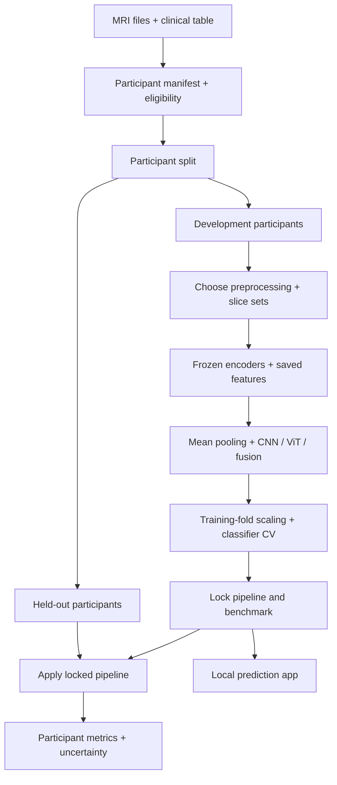

# Complete execution guide: OASIS-1 CNN–ViT dementia-status project

Prepared 24 October 2026. This is a build guide, not a report of completed experiments. Your downloaded MRI files have not been inspected or used to train a model here. Code snippets illustrate key components; named project scripts below are modules you must implement, not files supplied with this guide.

## 1. Understand the result you are building

**Application:** a local research app takes a supported, preprocessed structural brain MRI, displays selected slices, and predicts the participant's recorded CDR group: CDR = 0 or CDR > 0. It displays a model score, not a medical diagnosis or a validated probability of disease.

**Research question:** does combining CNN and ViT features improve this prediction enough to justify the extra processing, and how does the answer change with 4, 8 or 16 slices?

The application and research comparison are two deliverables of the same project. You will train a classifier that predicts a clinical-label group; the architecture comparison helps choose its image representation. Fusion need not win for the project to succeed.

| Term | Meaning in this project |
|---|---|
| MRI volume | A three-dimensional array representing a brain scan |
| Slice | A two-dimensional cross-section taken from that array |
| Feature/embedding | A list of numbers describing image patterns |
| Pretrained | Encoder weights were learned previously on another dataset |
| Frozen | Those encoder weights stay unchanged during your experiment |
| Mean pooling | Average corresponding feature values across a person's slices |
| Concatenation | Join the CNN and ViT feature lists end-to-end |
| Classifier | Logistic regression, which learns to map features to the two CDR groups |
| Leakage | Information from evaluation participants influences model development |
| Inference | Using the completed pipeline to predict a new supported input |

## 2. Lock the scope before coding

**Do:** use OASIS-1 only; start with age >= 60, available CDR, one usable session per participant. Compare frozen ResNet-18, frozen ViT-B/16, and their concatenation. Use mean pooling and regularised logistic regression. Compare 4/8/16 nested axial slice sets.

**Why:** a fixed, manageable scope makes model comparisons interpretable and avoids spending the semester collecting unrelated models.

**Save:** `config.yaml`, with inclusion rules, random seed, encoders and exact weights, preprocessing version, slice indices, split rules, primary metric and tuning grid. Final slice indices are entered only after development-image inspection.

Do not call the work a new CNN–ViT architecture. The potential contribution is controlled evidence about performance and computation under this protocol. No accuracy target or superiority claim is established yet.

## 3. Prepare your computer and folders

**Do:** use Python, VS Code or Jupyter, PyTorch/torchvision, NiBabel, NumPy, pandas, scikit-learn, matplotlib, joblib, PyYAML and Streamlit. A Python 3.11 environment is a reasonable starting choice, subject to the current supported PyTorch installation.

```powershell
python -m venv .venv
.venv\Scripts\Activate.ps1
python -m pip install --upgrade pip
```

Install PyTorch and torchvision together using the command for your system from https://pytorch.org/get-started/locally/ . Then:

```powershell
python -m pip install numpy pandas nibabel scikit-learn matplotlib joblib pyyaml streamlit psutil
python -m pip freeze > requirements-lock.txt
python -c "import torch; print(torch.__version__); print('CUDA:', torch.cuda.is_available())"
```

**Why:** an isolated environment avoids package conflicts; recording versions makes your results reproducible.

If using your GTX 1650 laptop, begin with batch size 1–4 and load one encoder at a time. This is a starting plan, not a measured memory guarantee. Frozen extraction avoids backpropagation but still needs encoder computation. Reduce batch size if memory runs out; classifier training can run on CPU. Use a small pilot to measure feasibility before committing to full extraction.

| Folder | Contents |
|---|---|
| `data/raw/` | Untouched OASIS archives/extracted source scans |
| `data/metadata/` | Original clinical spreadsheet |
| `data/processed/` | Validated processed arrays, if needed |
| `manifests/` | Participant table, exclusions, splits, CV folds |
| `features/` | Per-slice encoder features and their metadata |
| `models/` | Saved scalers/classifiers and configuration |
| `results/` | Metrics, predictions, plots, timing |
| `src/` | Reusable pipeline code |
| `app/` | Local Streamlit interface |

Keep dataset files and participant-level outputs out of public repositories. Follow the agreement you accepted when deciding storage, collaborators' access and retention.

## 4. Audit what you downloaded

**Do:** locate the original clinical CSV/XLS, release documentation, and processed MRI files. In the original release, prefer the brain-masked atlas-aligned intensity volume under `PROCESSED/T88_111`, with a name ending approximately `...111_t88_masked_gfc`.

Keep the matching `.hdr` and `.img` together. These are two parts of one Analyze image, not two independent samples. Do not use the `...fseg` tissue-label image as if it were the intended intensity MRI. Do not hard-code `n4`: the averaged volume can use a different number of acquisitions.

**Why:** this product already provides alignment, gain-field correction and brain masking, avoiding a raw-MRI preprocessing project. Different products must not be mixed accidentally. The official fact sheet documents these products and paired-file format [1].

**Check:** inventory paths, file sizes, missing pairs and failed loads. If your download has a different layout or only converted NIfTI files, first establish their provenance and preprocessing; do not silently assume equivalence.

**Save:** `inventory.csv`, with session ID, image path, header path, product type and load status.

## 5. Match each MRI to its clinical label

**Do:** read the clinical table and inspect actual column names and value types. Preserve IDs as text. Use session IDs to join images to metadata, and derive participant IDs separately so repeated sessions stay together.

Example: `OAS1_0012_MR1` is a session; `OAS1_0012` is the participant. Prefer MR1, or the earliest eligible session under a rule written before modelling. Select only one image product for that chosen session.

| Clinical value | Project label |
|---|---|
| CDR = 0 | 0 |
| CDR = 0.5, 1 or 2 | 1 |
| CDR absent or invalid | Exclude and record the reason |

**Why:** clinical metadata provides the supervised target. You are not generating the true CDR from visual inspection of an MRI. The classifier learns associations with the recorded rating. The original fact sheet defines the CDR values [1].

**Save:** `participants.csv` containing `subject_id, session_id, image_path, age, cdr, label`. Save exclusions separately. Assert one row per participant, one unique intended image per row, no missing required values, and no conflicting duplicate clinical records. Resolve discrepancies rather than selecting the first match blindly.

Restrict to age >=60, then report actual eligible counts by group. Do not use the total published dataset size as your final sample size. Do not feed CDR, MMSE, filenames or participant IDs into the MRI classifier. Age is for eligibility and a separate baseline.

## 6. Split participants before model development

**Do:** reserve a stratified 20% participant test set; retain 80% for development. Use a fixed seed, such as 42, and save the assignments. On development participants create five stratified CV folds if class counts permit; otherwise reduce folds and explain why.

```python
from sklearn.model_selection import train_test_split
dev, test = train_test_split(
    participants, test_size=0.20, random_state=42,
    stratify=participants['label'])
assert set(dev.subject_id).isdisjoint(set(test.subject_id))
```

**Why:** similar slices from one person would make evaluation misleading if spread across training and testing. Cross-validation selects settings without repeatedly looking at final-test performance.

**Check:** both classes exist in each subset; all slices/sessions of a participant follow the same assignment. Save identical CV folds for all nine experiments. Lock label-blind QC rules before applying them to the final-test cohort. Never replace a split simply because its score looks low.

## 7. Load and visually check development MRIs

**Do:** start with 5–10 development participants. Inspect dimensions, voxel sizes, finite intensities, orientation, nonzero brain coverage and the three anatomical planes. Compare against the OASIS documentation and a trusted medical-image viewer.

```python
import nibabel as nib
import numpy as np
img = nib.load('path/to/the_selected_scan.hdr')
print(img.shape, img.header.get_zooms())
print(nib.aff2axcodes(img.affine))
volume = np.asarray(img.dataobj, dtype=np.float32)
if volume.ndim == 4 and volume.shape[-1] == 1:
    volume = volume[..., 0]
assert volume.ndim == 3
assert np.isfinite(volume).all()
```

**Why:** a model can run successfully on a sideways, empty or wrongly selected image. An apparently valid array is insufficient.

Analyze headers have limited orientation information. A reported affine can reflect a library convention rather than verified anatomy. Validate against release conventions and visual anatomy before trusting axis names. NiBabel canonical reorientation can reorder/flip axes; it does not perform brain registration [2]. Do not invent a NIfTI affine merely to make files load.

**Save:** QC montages and a written orientation/preprocessing decision. Reject objectively unusable images under fixed criteria and log every exclusion. Do not exclude participants because they are hard for the model to classify.

## 8. Implement one deterministic preprocessing function

**Do:** once image geometry is verified, use the following fixed recipe:

1. Load the selected brain-masked, registered volume.
2. Apply the verified orientation convention consistently.
3. Identify valid brain voxels using the documented mask; for the supplied zero-background masked image, a validated nonzero mask can be used.
4. Compute 1st and 99th intensity percentiles within that brain region for this volume.
5. Clip and rescale the brain intensities to [0,1]; keep background zero. Reject empty masks or equal percentile bounds.
6. Extract the selected axial planes.
7. Pad each full slice to a square and resize to 224×224, keeping anatomy in view.
8. Copy grayscale into three identical channels.
9. Apply the input-channel mean/std for the chosen pretrained weights.

**Why:** intensity scaling reduces arbitrary brightness variation; square padding avoids stretching the anatomy; 224×224 and three channels match the selected encoder inputs. Repeating channels adds no new biological information.

Use the same geometry for both encoders. Explicitly record that square-padding/resizing is your MRI adaptation, rather than claiming it is the complete stock torchvision resize/centre-crop recipe. ImageNet V1 channel normalisation is mean `[0.485,0.456,0.406]`, std `[0.229,0.224,0.225]` [3,4]. Do not apply normalisation twice.

**Check:** transformed slices are finite, correctly oriented and not cropped through the brain. View both the pre-normalisation image and its model input after reversing channel normalisation. Use this exact function in the demo.

Per-volume normalisation can be applied to an unseen volume because it uses only that input. Any normalisation learned across people must be fitted only on training folds.

## 9. Choose nested 4-, 8- and 16-slice sets

**Do:** inspect development volumes and select an anatomical range with useful brain coverage. In verified common atlas geometry, choose 16 unique approximately evenly distributed positions in that range. Save exact indices and spatial conventions.

An example of nested positions within that 16-slice list, numbered 0–15:

| Budget | Positions within the chosen list |
|---|---|
| 16 | All 0–15 |
| 8 | 0, 2, 4, 6, 9, 11, 13, 15 |
| 4 | 0, 4, 11, 15 |

These are list positions, not raw MRI voxel indices. Do not copy an arbitrary raw index from another implementation without checking geometry. If volume shapes/affines differ, resolve the common grid before using fixed indices.

**Why:** nested subsets isolate how the amount of image information changes results. Selecting apparently abnormal slices by eye or using test results to choose positions biases the study.

**Check:** no duplicates, all positions in bounds, consistent anatomical coverage across development subjects. Four slices are four cross-sections from one MRI; they are not four separate MRI appointments.

## 10. Create frozen CNN and ViT encoders

**Do:** explicitly select pretrained weight versions, remove output classification heads and run in evaluation mode.

```python
import torch
from torch import nn
from torchvision.models import (
    resnet18, ResNet18_Weights, vit_b_16, ViT_B_16_Weights)

cnn = resnet18(weights=ResNet18_Weights.IMAGENET1K_V1)
cnn.fc = nn.Identity()
vit = vit_b_16(weights=ViT_B_16_Weights.IMAGENET1K_V1)
vit.heads = nn.Identity()
for encoder in (cnn, vit):
    encoder.eval()
    encoder.requires_grad_(False)

# x must already be a correctly preprocessed B×3×224×224 tensor.
# Move the chosen encoder and x to the same device before calling it.
with torch.inference_mode():
    cnn_features = cnn(x)  # B×512
    vit_features = vit(x)  # B×768
```

On limited GPU memory, run this as separate CNN and ViT extraction jobs, moving only the active encoder to GPU.

**Why:** the CNN and ViT encode image patterns differently, so their combination may provide useful complementary information. This is a hypothesis. CNN representations can include broad context too; a 2D ViT attends across one slice, not the whole 3D brain. Frozen weights make initial training and feature reuse manageable; they may also limit adaptation from natural images to MRI.

**Check:** output dimensions, finite values, inference mode, deterministic repeat behaviour and input sensitivity. Features of distinct slices should not all be identical. There is no optimiser for the encoders in this baseline.

## 11. Cache per-slice features

**Do:** process all development participants using the fixed pipeline and save numeric arrays plus ID/config metadata. Process final-test participants only after the pipeline is locked, or keep any earlier fixed extraction inaccessible to model selection.

| Array | Shape |
|---|---|
| CNN features | N×16×512 |
| ViT features | N×16×768 |
| Participant IDs | N |
| Slice indices | 16 |

**Why:** caching avoids repeatedly running expensive encoders during classifier experiments. Keep slice-level features so smaller budgets can be derived later.

Save preprocessing version/hash, original input identifiers, weight versions, software versions and participant order. Match arrays by ID, not assumptions about file sorting. A cache is invalid after changes to weights, input geometry, normalisation or slice positions.

**Check:** every expected participant has exactly 16 valid embeddings from each encoder. Save progressively so an interrupted job can resume. Do not count cached-file loading as MRI feature-extraction speed.

## 12. Mean-pool and concatenate

**Do:** for each slice budget, average only that subset's feature vectors separately for each encoder.

```python
import numpy as np
# cnn_all: N×16×512; vit_all: N×16×768, with identical subject order
idx = [0, 4, 11, 15]  # four-slice condition
X_cnn = cnn_all[:, idx, :].mean(axis=1)
X_vit = vit_all[:, idx, :].mean(axis=1)
X_fusion = np.concatenate([X_cnn, X_vit], axis=1)
assert X_fusion.shape[1] == 1280
```

**Why:** pooling produces one representation and one prediction per participant. Concatenation preserves both sets of feature values. Averaging CNN and ViT vectors together would be a different operation and their dimensions do not match.

Simple example: slice embeddings `[2,4]` and `[4,8]` average to `[3,6]`. Joining this CNN result with ViT values `[1,5,9]` gives `[3,6,1,5,9]`.

**Limitation:** mean pooling discards slice order and weights all slices equally. Keep this simple baseline before considering learned slice attention.

## 13. Train the classifier and choose settings

**Do:** fit StandardScaler followed by class-balanced L2 logistic regression. Try `C = 0.001, 0.01, 0.1, 1.0`, with the same folds and ROC-AUC scoring for every configuration.

```python
from sklearn.pipeline import Pipeline
from sklearn.preprocessing import StandardScaler
from sklearn.linear_model import LogisticRegression
from sklearn.model_selection import GridSearchCV, StratifiedKFold

cv = list(StratifiedKFold(n_splits=5, shuffle=True,
                         random_state=42).split(X_dev, y_dev))
pipe = Pipeline([
    ('scale', StandardScaler()),
    ('clf', LogisticRegression(class_weight='balanced',
                               max_iter=5000, solver='lbfgs'))
])
search = GridSearchCV(pipe, {'clf__C':[0.001,0.01,0.1,1.0]},
                      cv=cv, scoring='roc_auc', refit=True, n_jobs=-1)
search.fit(X_dev, y_dev)
```

**Why:** the scaler prevents differences in feature scale dominating the classifier; regularisation limits large coefficients; class weighting accounts for imbalanced groups. Smaller C means stronger regularisation. Pipelines ensure the scaler is fitted within each training fold [5].

Generate folds once in a fixed participant order and reuse them. Do not scale the complete dataset before CV. If optional PCA or feature selection is introduced, it also belongs inside the pipeline. Reduce `n_jobs` if RAM becomes a problem. Check convergence warnings rather than ignoring them.

**Save:** each configuration's CV results, selected C and refitted pipeline. Do not describe the best selected CV score as an unbiased final performance estimate; that is the held-out test's role.

## 14. Run the nine planned comparisons and the age baseline

| Encoder representation | Slice budgets |
|---|---|
| CNN only | 4, 8, 16 |
| ViT only | 4, 8, 16 |
| CNN + ViT | 4, 8, 16 |

**Do:** keep participant order, folds, classifier type, scaling and tuning grid identical. Separately train a logistic model using age alone on the same development/test split.

**Why:** controlled comparisons show whether changes arise from representations and slice budgets. The age baseline checks whether a simple demographic cue already predicts much of the outcome. It does not prove absence of confounding.

Compare age distributions by class, and if sample sizes allow inspect performance across age bands. Predefine a selection rule: e.g. maximise development CV AUC and use lower extraction cost as a tie-breaker under a declared tolerance. Similar point estimates alone do not establish statistical equivalence.

## 15. Measure actual computational costs

**Do:** on the same hardware, benchmark MRI loading/preprocessing, encoder extraction, aggregation/classifier prediction, and total inference separately. Measure classifier fitting separately. For each slice budget actually run 4/8/16 slices; do not retrieve all 16 cached vectors and call that a four-slice runtime.

Warm up the model, repeat measurements, and report median and variation. Synchronise CUDA immediately before starting and stopping a GPU timer. Report batch size, precision, device, whether model loading is included, and peak GPU allocation / system RAM. If fusion uses sequential encoder loading to fit memory, report that execution policy and its reload cost separately.

**Why:** frozen means no encoder updates, not zero extraction cost. A fusion accuracy gain might not justify its extra latency and memory.

**Save:** `timings.csv` with representation, slice budget, device, timing stage and repetitions. Keep the cold-start and warmed-inference results distinct.

## 16. Lock the model, then evaluate on held-out participants

**Do:** freeze preprocessing, slices, feature definitions, selected C values and threshold before opening final-test results. A threshold of 0.5 is a simple default; any alternative must be chosen only on development predictions.

Evaluate the predefined nine pipelines once if the comparison is part of the study. Select the deployment candidate from development evidence, not whichever wins the test table.

| Metric | Interpretation |
|---|---|
| ROC-AUC | Ranking separation between recorded CDR groups |
| Balanced accuracy | Average of sensitivity and specificity |
| Sensitivity | Fraction of CDR-positive participants correctly identified |
| Specificity | Fraction of CDR-zero participants correctly identified |
| F1 | Balance of positive-class precision and recall |
| Confusion matrix | Numbers of each correct/incorrect prediction |

Use one prediction per person. Include participant-level bootstrap confidence intervals; for differences between models resample the same participants for both models. A stratified bootstrap can preserve both groups in a small test cohort. Report broad uncertainty honestly.

**Why:** the held-out set tests generalisation beyond development participants. A small test set may give noisy estimates, so confidence intervals matter. No external dataset means no demonstrated generalisation to other hospitals.

**Save:** prediction table, metrics, confusion matrices, ROC plots and accuracy-versus-time plot. Do not invent example performance numbers in your final report. Once test results are inspected, subsequent redesign is exploratory and needs fresh evaluation for a new confirmatory claim.

## 17. Investigate mistakes and, optionally, robustness

**Do:** inspect wrong predictions for poor image quality, low brain coverage, age differences or label grouping. Explain observed error patterns without claiming a heatmap proves a medical mechanism.

If time remains, predefine mild Gaussian noise/blur settings on development data and apply the same perturbations to all representations. Recompute features; clean cached features cannot simulate a perturbed image.

**Why:** error analysis reveals limitations. Noise/blur experiments test synthetic perturbations only; they do not demonstrate scanner or clinical robustness. Keep this optional until the core project works.

## 18. Package the inference pipeline

**Do:** save the fitted scaler+classifier together using joblib, along with encoder weight identifiers, preprocessing version, slice indices, selected representation, label mapping and threshold.

```python
import joblib
joblib.dump(search.best_estimator_, 'models/final_pipeline.joblib')
```

Use your chosen configuration's fitted estimator, not whichever variable happened to run last. Load only trusted model files.

**Why:** a classifier without its scaler and preprocessing cannot reproduce its evaluated behaviour.

**Check:** for a supported sample, a fresh process must reproduce the offline score within an explicitly chosen floating-point tolerance. For a demo of the held-out model, keep the evaluated development-trained artifact; fitting again on the test participants creates a different model whose displayed performance is not newly validated.

## 19. Build the local Streamlit frontend

**Do:** first support a dropdown of locally stored, authorised sample MRIs already in the required processed format. Add an Analyse button, slice montage, predicted CDR group, model score, selected model/slice budget and measured processing time. Keep the research comparison table in a separate panel.

Use one shared `predict_volume()` function for both app and offline inference. An eventual upload feature must validate format, geometry and preprocessing. Analyze input requires the header and image pair; a validated converted NIfTI can be a simpler later option. Arbitrary screenshots or raw clinical scans are not equivalent to this model's input.

Suggested app wording: “Research prediction: CDR-positive group” or “Research prediction: CDR-zero group”; “Model score”; “Academic prototype; not clinically validated.” Do not label an uncalibrated score as a percentage chance of dementia.

**Why:** this turns the experiment into a usable demonstration while keeping input requirements clear.

After implementing `app/app.py`, run:

```powershell
python -m streamlit run app/app.py
```

**Check:** offline/app predictions match; changing the model or sample invalidates the appropriate cache; malformed input produces a clear error; the app never reads the sample's true CDR to generate its prediction. Reference labels may be shown separately after prediction for evaluation.

## 20. Suggested modules and completion gates

These are implementation targets, not already-generated scripts.

| Module | Responsibility | Done when |
|---|---|---|
| `inventory.py` | Locate selected products and paired files | Missing/ambiguous files reported |
| `build_manifest.py` | Join metadata, enforce cohort rules | One valid row per participant |
| `make_splits.py` | Persist participant/test/CV assignments | No participant overlap |
| `preprocess.py` | Shared deterministic MRI transformation | QC montages and inputs verified |
| `extract_features.py` | Frozen encoder inference and cache | Expected per-slice shapes and IDs |
| `train.py` | Nine CV experiments plus age baseline | Saved development-only results |
| `benchmark.py` | Actual uncached timing/memory | Reproducible hardware log |
| `evaluate.py` | Locked held-out evaluation | One prediction/person, uncertainty |
| `predict.py` | Reload and run selected pipeline | Offline/reloaded scores match |
| `app/app.py` | Local demonstration | Same scores as `predict.py` |

## 21. End-to-end flow



## 22. Write the report and prepare the review

**Do:** include problem, application, related work, proposed contribution, cohort flow/exclusions, label definition, image preprocessing, architecture, split protocol, nine comparisons, costs, uncertainty, error analysis, demo and limitations. Cite OASIS and encoder papers/documentation.

**Why:** the report must explain both what the software does and whether the evidence supports your claims.

Required final deliverables: reproducible source, environment lock file, immutable configuration/splits, saved selected pipeline, experimental result CSVs, plots, local frontend, report, presentation and a short demo recording. Distribute only materials allowed under the data agreement; do not bundle OASIS scans with public project code.

Success is an honest answer to the research question plus a reproducible working prototype, even if CNN-only is best. Avoid claims of clinical diagnosis, guaranteed early detection, a first-ever architecture or confirmed performance before results exist.

## 23. Practical work schedule

| Phase | Planning estimate | Main output |
|---|---|---|
| Dataset and environment audit | 2–3 working days | Inventory, metadata match, first MRI |
| Cohort, split, QC and preprocessing | 3–5 days | Validated manifests and slice montages |
| CNN pilot and classifier | 2–3 days | First complete development pipeline |
| ViT extraction and nine experiments | 3–5 days | Feature cache and CV results |
| Timing, locked evaluation and analysis | 2–4 days | Metrics, plots and uncertainty |
| Local app and report | 4–6 days | Working demo and submission |

These are planning estimates, not measured runtimes. A beginner should allow additional learning/debugging time. Measure extraction runtime using a small development pilot and estimate remaining work from observed time per participant. Do not launch full jobs until the pilot passes.

## 24. Troubleshooting

| Symptom | Check first |
|---|---|
| No images detected | Nested archives; actual directory layout and suffixes |
| MRI fails to load | Missing or mismatched `.hdr`/`.img` pair |
| Wrong anatomical plane | Analyze orientation convention; viewer verification |
| Near-perfect results unexpectedly | Participant overlap, duplicate sessions, label-derived inputs |
| Poor results | Label matching, image selection, normalisation, anatomy, domain mismatch |
| ViT GPU out of memory | Batch size, active encoders, disabled gradients |
| Fusion worse than CNN | Redundant features, high dimensionality, C tuning; report honestly |
| App score differs | Wrong scaler, weights, slices, preprocessing or stale cache |
| Timing looks implausibly fast | Cached embeddings, asynchronous GPU execution |

## 25. Your first session

1. Create the environment and directories.
2. Locate the clinical CSV and one processed MRI pair.
3. Open the table and print its columns.
4. Match that session's ID to the correct clinical row.
5. Load the MRI and inspect shape, voxel size and planes.
6. Save a three-plane montage and one validated participant row.

Do not begin by training on every image. Your first milestone is one correctly understood MRI matched to its recorded CDR.

## Sources and implementation references

The OASIS landing page returned a retrieval error during preparation; the original official fact sheet was accessible and used for the release-format details. Actual downloaded layout must still be checked.

1. [OASIS-1 official fact sheet](https://bpb-us-e2.wpmucdn.com/sites.wustl.edu/dist/6/4383/files/2024/03/oasis_cross-sectional_facts-bcc7a002dfb104f4.pdf); [dataset page](https://sites.wustl.edu/oasisbrains/home/oasis-1/). See the original Marcus et al. 2007 dataset paper cited in the fact sheet.
2. [NiBabel image orientation](https://nipy.org/nibabel/image_orientation.html).
3. [Torchvision ResNet-18](https://docs.pytorch.org/vision/main/models/generated/torchvision.models.resnet18.html).
4. [Torchvision ViT-B/16](https://docs.pytorch.org/vision/stable/models/generated/torchvision.models.vit_b_16.html).
5. [Scikit-learn leakage and pipelines](https://scikit-learn.org/stable/common_pitfalls.html).
6. [PyTorch installation selector](https://pytorch.org/get-started/locally/).

The cohort rules, slice budgets, training design, app scope and QC gates above are proposed implementation decisions for this project, rather than claims that the dataset or encoder authors prescribe this exact experiment.
