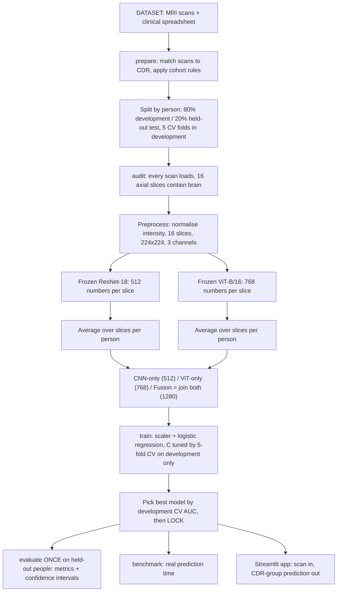

# Project summary: CNN–ViT feature fusion for MRI-based dementia classification

## 1. In one paragraph
We take a structural brain MRI from the OASIS-1 dataset and predict whether the person's recorded
**Clinical Dementia Rating (CDR)** is **0 (no dementia)** or **above 0 (very mild to moderate dementia)**.
Two pretrained image networks, a CNN (ResNet-18) and a Vision Transformer (ViT-B/16), are used **frozen**: they only convert
MRI slices into numerical features. A small logistic-regression classifier is trained on those features.
The research question is whether **combining** CNN and ViT features (fusion) predicts the CDR group better than
either network alone, and whether any gain is worth the extra computation. The project also delivers a local web app
that runs the trained model on a scan. It is an academic prototype, not a diagnostic tool.

## 2. Research question
> Does concatenating frozen CNN and ViT slice features improve participant-level CDR-group classification over CNN-only
> or ViT-only features, and at what computational cost? (Full suite only: how does this change with 4, 8 or 16 slices?)

Fusion does not have to win. A well-controlled result in which fusion does not help is still a valid answer.

## 3. Data
| Item | Detail |
|---|---|
| Dataset | OASIS-1 cross-sectional (Marcus et al., 2007): 416 people aged 18–96, 436 scan sessions |
| Location | `C:\AUTISM-Project\DATASET\` (disc folders, clinical spreadsheet, fact sheet) |
| Image used | `PROCESSED/MPRAGE/T88_111/*_t88_masked_gfc` – the skull-stripped brain, aligned to a standard atlas, 176×208×176 voxels at 1 mm |
| Labels | `oasis_cross-sectional-5708aa0a98d82080.xlsx`: columns ID, Age, CDR |
| Cohort rule | Age ≥ 60, CDR recorded as 0 / 0.5 / 1 / 2, first session only (one row per person) |
| Target | CDR = 0 → class 0; CDR > 0 → class 1 |
| Size | Full dataset: 198 eligible (98 CDR 0, 100 CDR > 0). Discs 1–6 currently on disk: 94 eligible (48 / 46) |

CDR, MMSE and other clinical scores are **never** given to the image model. CDR is only the answer it learns to predict.
Age is used only in a separate age-only baseline that checks whether age alone already explains the result.

## 4. Pipeline flow

| Step | Command | What happens | Output |
|---|---|---|---|
| 0 | `python run.py doctor` | Checks Python packages, GPU, and that both pretrained networks run | `outputs/environment.json` |
| 1 | `python run.py prepare` | Finds every scan, joins it to its spreadsheet row, applies age/CDR rules, keeps one session per person, splits people 80/20 with a fixed seed | `participants.csv`, `exclusions.csv`, `prepare_summary.json` |
| 2 | `python run.py audit` | Loads every development scan with the fixed preprocessing and checks the 16 slices | `qc/audit_dev.csv`, slice montages `qc/*.png` |
| 3 | `python run.py extract` | Runs each scan's 16 slices through the frozen networks once and saves the features | `features/cnn/*.npz` (16×512), `features/vit/*.npz` (16×768) |
| 4 | `python run.py train` | Trains each model in the suite plus age-only, tunes C by cross-validation, picks the best, locks everything | `results/dev_cv_results.csv`, `models/*.joblib`, `models/lock.json` |
| 5 | `python run.py extract --split test` | Features for the held-out people (only allowed after the lock) | test feature files |
| 6 | `python run.py evaluate` | Scores every model once on the held-out people | metrics, ROC, confusion matrices (see section 6) |
| 7 | `python run.py verify` | Live prediction on a scan must equal the prediction from its saved features | `results/prediction_consistency.json` |
| 8 | `python run.py benchmark` | Times real end-to-end prediction for each model on 5 dev scans (first run cold, then warm) and records peak GPU memory | `results/timings.csv`, `results/timings_summary.csv` |
| 9 | `python run.py report` | Joins accuracy and cost for all configurations; picks the cheapest model that keeps dev performance | `results/cost_vs_auc.csv/png`, `auc_vs_slices.png`, `age_by_class.png`, `report.json` |
| 10 | `streamlit run app.py` | Local web demo | browser page at `http://localhost:8501` |

## 5. What is trained and what is not
| Component | Trained on our data? | Notes |
|---|---|---|
| ResNet-18 | No | ImageNet weights, frozen; its output layer is removed |
| ViT-B/16 | No | ImageNet weights, frozen; its output layer is removed |
| Slice averaging and fusion | No | Fixed arithmetic: mean over slices, then join CNN + ViT |
| StandardScaler | Yes | Refitted inside each cross-validation training fold, so no information leaks |
| Logistic regression | Yes | Class-balanced, L2; C chosen from {0.001, 0.01, 0.1, 1} by CV ROC-AUC |
| Age-only model | Yes | Baseline for age confounding; never used in the app |

Models trained per suite (set `suite:` in `config.yaml`, default `full` = the 9 configurations of the Review-1 slides):

| Suite | MRI models | Plus |
|---|---|---|
| full | cnn, vit, fusion × 4, 8, 16 slices (9 models) | age_only |
| review | cnn_16, vit_16, fusion_16 | age_only |
| cnn | cnn_16 | age_only |

## 6. What you get after running the pipeline
Everything is written to `dementia_project/outputs/`. Nothing here is uploaded anywhere.

| File | What it tells you |
|---|---|
| `prepare_summary.json` | How many people were included per class and split, and why others were excluded |
| `qc/*.png`, `qc/audit_*.csv` | Visual proof the slices are correct; pass/fail for every scan |
| `results/dev_cv_results.csv` | Cross-validated AUC (± spread across folds) and classifier fit time for every model on development data; this decides the app model |
| `results/dev_budget_table.csv` | Dev CV AUC as a 3 × 3 grid: representation × 4/8/16 slices |
| `models/lock.json` | Selected model, suite, and fingerprints of everything that must not change before testing |
| `results/test_metrics.csv` | **Main result.** For each model on held-out people: ROC-AUC, balanced accuracy, sensitivity, specificity, F1, confusion counts, each with a 95% bootstrap confidence interval |
| `results/test_roc.png` | ROC curves of all models on one plot |
| `results/confusion_<model>.png` | Correct and incorrect predictions per class |
| `results/paired_auc_differences.csv` | **Answers the research question**: `representation` rows = fusion minus CNN / ViT at each budget; `budget` rows = 16 slices minus 8 or 4 for each representation. Each has a CI; if it includes 0, the difference is not shown |
| `results/test_predictions.csv` | The score each model gave each held-out person |
| `results/prediction_consistency.json` | Confirms the app and the evaluated model produce the same score |
| `results/timings_summary.csv` | Median warm seconds per participant, cold time and peak GPU memory (MB) for each model |
| `results/cost_vs_auc.csv` | **The nine-configuration results table**: dev CV AUC, test AUC with CI, other metrics, fit time, s/participant, GPU memory |
| `results/cost_vs_auc.png`, `auc_vs_slices.png` | Accuracy vs cost, and accuracy/cost vs number of slices |
| `results/report.json` | The cheapest configuration that retains performance (chosen on dev), plus age by class |
| `results/age_by_class.png` | Age distribution of CDR 0 vs CDR > 0 (age is a confounder) |
| App | Pick a participant or upload a scan; shows the slices, predicted CDR group, model score and time |

### How to read the results
- **ROC-AUC** (0.5 = guessing, 1.0 = perfect ranking) is the primary metric. Compare it with **age_only**: if age alone scores
  similarly, the MRI models may mainly be detecting age.
- **Balanced accuracy, sensitivity, specificity** use a fixed threshold of 0.5 on the model score.
- **Confidence intervals** will be wide because the test set is small (about 40 people with all discs, 19 with discs 1–6).
- **The conclusion** comes from `paired_auc_differences.csv` together with `cost_vs_auc.csv` / `report.json`: does fusion
  (or more slices) improve AUC by enough to justify the extra time and memory?

Only numbers from these output files may appear in the report or slides. No accuracy is promised in advance.

## 7. Safeguards built into the code
- People, not slices, are split. No person appears in both development and test.
- Slice choice, preprocessing and C are decided using development data only.
- After `train`, any change to the participant list, slices, geometry or threshold is detected and refused.
- Test features can only be extracted after the lock, and `evaluate` refuses to run twice.
- The app hides held-out people until evaluation is done, and never reads CDR to make its prediction.

## 8. Limitations to state in the review
- One dataset (OASIS-1), with no external hospital validation.
- Frozen networks were trained on everyday photos (ImageNet), not MRI.
- 2-D slices with simple averaging: 3-D context and slice order are not modelled.
- The CDR group is not a confirmed Alzheimer's diagnosis, and the model score is not a calibrated probability.
- The test set is small, so differences between models may not be statistically clear.

## 9. Current status
- Code complete and unit-tested on synthetic data. `prepare` and `audit` have been checked on the real scans (94 people on discs 1–6, all scans passed).
- To do: install torch/torchvision (CUDA build for the RTX 3050 Ti) and openpyxl, extract the remaining OASIS discs into `DATASET/`,
  then run the steps in section 4.
