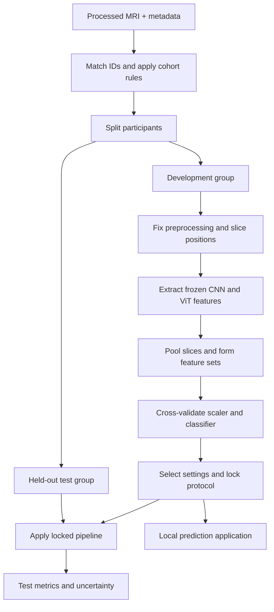

# Our project explained: problem, application, method and expected outputs

**Project:** MRI-Based Dementia Status Classification Using CNN–Vision Transformer Feature Fusion: A Study of Predictive Performance and Computational Cost  
**Team:** Arnav Srivastava — 23BEI0017; Kaustubh Shandilya — 23BEL0014  
**Institution:** Vellore Institute of Technology, Vellore  
**Guide listed in the supplied presentation:** Dr. M Monica Subashini, Professor, SELECT  
**Updated:** 27 October 2026

This explanation combines the supplied Review-I presentation, our agreed methodology and the result screenshots shared in this conversation. It distinguishes intended functionality from demonstrated results. The friend's current source code, participant manifest and complete output files have not been audited here. Listing a project guide does not imply clinical endorsement or verification of these results.

## 1. What exactly are we building?

We are building a **local research application that takes a supported processed brain MRI and predicts which of two recorded Clinical Dementia Rating (CDR) groups the participant belongs to**:

- **Class 0:** recorded CDR = 0.
- **Class 1:** recorded CDR > 0, including 0.5 in our chosen grouping.

The application displays a predicted group, a model score, representative MRI slices and processing time. It uses a classifier trained on OASIS-1 MRI features and the corresponding clinical labels.

Alongside the application, we are conducting a controlled experiment to determine whether combining CNN and Vision Transformer features improves prediction sufficiently to justify the additional computation. The full planned study also asks how the result changes when we use 4, 8 or 16 slices per person.

There are therefore two connected deliverables:

| Deliverable | What it does | How we judge it |
|---|---|---|
| Prediction application | Processes a supported MRI and returns a participant-level CDR-group score and prediction | Correct input handling, reproducible predictions and agreement with the evaluated pipeline |
| Experimental study | Compares CNN, ViT and their fusion under a common protocol | Held-out predictive metrics, uncertainty, measured cost and fair comparisons |

The model comparison helps us choose and understand the application model. The application makes the trained model usable for an academic demonstration. A working interface alone does not demonstrate that the classifier is accurate.

### A concrete example

A reviewer selects one authorised, supported OASIS sample in the local interface. The system loads its MRI volume, selects the same slice positions used during model development, extracts features and applies the saved classifier. It then displays a CDR-group prediction.

It does **not** read that participant's CDR from the spreadsheet to generate the prediction. A known CDR can be shown separately as a reference label for a demonstration, but it must be clearly distinguished from the model output.

The immediate users are the student team, faculty reviewers and researchers exploring this pipeline. Clinical deployment is a possible future research direction requiring substantially more validation, not the current application.

## 2. What problem are we solving?

### 2.1 The prediction problem

We want to test whether numerical features extracted from structural brain MRI can distinguish participants with recorded CDR = 0 from participants with recorded CDR > 0 in the selected OASIS-1 cohort.

In machine-learning terms, this is **supervised binary classification**:

- Supervised: examples come with recorded target labels.
- Binary: the project predicts one of two groups.
- Classification: it assigns a group rather than outlining a lesion or estimating a future event.

The technical challenge is that an MRI contains many voxels, whereas our usable number of independent participants is relatively small. The model must learn patterns that transfer to other participants instead of memorising individual images or exploiting shortcuts.

### 2.2 The model-design problem

We have two different ways to describe an MRI slice numerically: a CNN and a ViT. Combining them creates more features and requires running both networks. That extra work is useful only if the resulting performance gain is worthwhile for the research setting.

Our main question is:

> Under a fixed participant-level evaluation protocol, does combining frozen CNN and ViT features improve CDR-group discrimination over either representation alone, and what additional processing cost does it incur?

The full study adds:

> How does this trade-off change when the classifier uses 4, 8 or 16 consistently selected MRI slices?

### 2.3 The resource problem

We want a reproducible semester project that can run on the available NVIDIA RTX 3050-class computer with 16 GB system RAM. Frozen feature extraction and a small classifier reduce training demands. Actual speed and GPU memory still need measurement on the training system.

This is a feasibility-oriented design. It does not establish that the approach is the fastest possible, or that ViT-B/16 is intrinsically lightweight.

### 2.4 Problems outside this project's scope

We are not building a system that confirms Alzheimer's disease, recommends treatment, identifies all causes of dementia, predicts future dementia progression, segments diseased tissue, or accepts arbitrary clinical scans without preparation. We are not establishing that MRI alone can replace a clinical assessment.

Our output is a prediction of the dataset's CDR grouping. This is narrower and more defensible than saying “the application diagnoses dementia.”

## 3. What data enters the system?

The project uses OASIS-1 structural MRI and its associated clinical/demographic table. The original source is the [official OASIS-1 dataset page](https://sites.wustl.edu/oasisbrains/home/oasis-1/).

| Data item | Purpose | Used as a feature by the MRI classifier? |
|---|---|---|
| Processed structural MRI | Supplies the image information | Yes, through extracted embeddings |
| Recorded CDR | Defines the training/evaluation target | No |
| Participant ID | Matches images to labels and prevents participant overlap | No |
| Session ID | Selects one documented session per person | No |
| Age | Applies the planned cohort restriction and supports a separate baseline | No, for the MRI models |
| MMSE and other clinical scores | Outside the image-feature model in this implementation | No |

### 3.1 How labels are assigned

Each selected MRI is joined to the appropriate metadata row by its identifier. The program reads the recorded CDR and maps it to 0 or 1. It does not infer the ground-truth CDR by visually inspecting the MRI.

| Metadata value | Project label | Treatment |
|---|---:|---|
| CDR = 0 | 0 | Include if other eligibility rules pass |
| CDR = 0.5, 1 or 2 | 1 | Include if other eligibility rules pass |
| Missing CDR | None | Exclude and record why |

CDR = 0 should not be described as proof that a person has no neurological condition. Similarly, our positive grouping should not be described as confirmation of a particular disease cause. The binary mapping also does not predict the exact original severity score.

### 3.2 Planned cohort

Our agreed protocol starts with participants aged 60 or older, a valid CDR label and a usable scan. It retains one documented session per participant. The age restriction reduces the opportunity to distinguish young controls from older affected participants, but it does not eliminate confounding.

Use the final participant manifest to report the actual cohort. Earlier conversation counts and partial-download counts are not interchangeable with the final run. Record the exact age rule, exclusion reasons, class counts and split counts with every results table.

### 3.3 Supported image product

Use the release's consistently processed, brain-masked, atlas-aligned image product. Confirm its exact directory structure on disk rather than assuming every download has the same nesting.

An Analyze-format scan typically needs both the matching `.hdr` header and `.img` voxel-data file. A supported NIfTI conversion must preserve the expected image geometry. JPEG screenshots and raw scanner inputs are not equivalent replacements.

The application assumes this preparation has already been completed. It is not a general skull-stripping, registration or clinical DICOM-processing service.

## 4. What is a slice, and why do we use it?

A structural MRI is a 3D volume. A slice is a 2D cross-section through that volume, similar to one page within a stack of pages. An axial slice represents a horizontal cross-section.

Our encoders accept 2D images. We therefore select multiple fixed axial positions from each participant's processed volume and encode each slice separately.

| Slice budget | Interpretation | Main trade-off |
|---|---|---|
| 4 | Four selected cross-sections per person | Less image processing, but less sampled anatomy |
| 8 | Eight selected cross-sections per person | Intermediate sampling and extraction cost |
| 16 | Sixteen selected cross-sections per person | More sampled anatomy and more extraction work |

More slices do not guarantee better performance. They can add redundant information, and simple averaging can dilute useful signals. Sixteen slices also do not represent every voxel in the 3D brain.

For fair experiments, the 4-slice positions are contained in the 8-slice positions, and both are contained in the 16-slice set. These are **nested subsets**. Their anatomical range and positions are chosen from development data and fixed before test evaluation.

One person supplying sixteen slices is still **one independent participant**. We do not claim a larger patient sample by counting slices as people.

## 5. How the end-to-end pipeline works

### Step 1 — Match scans and labels

Create a table with participant ID, session, MRI path, age, recorded CDR and binary label. Check missing files, missing labels and repeated sessions.

**Why:** a correctly implemented model trained on mismatched labels is still learning the wrong task.

### Step 2 — Split participants

Reserve the planned 20% of people for testing and use the remaining 80% for development. Stratify by the target label so both groups are represented. Keep every scan and slice from the same participant together.

**Why:** the model must be evaluated on people it has not used for training or model selection. Splitting slices separately can put closely related images of the same person into both groups.

### Step 3 — Inspect anatomy and fix geometry

Check the processed image product, array orientation, shape, voxel spacing and shared anatomical space. Choose the axial direction and slice range using development examples. Save these decisions in configuration.

**Why:** the same array index should correspond to a comparable anatomical position. A shape check or plausible montage alone cannot prove that the orientation is correct. Anatomical review remains necessary.

### Step 4 — Preprocess the MRI

Apply the same fixed procedure at extraction and prediction time:

1. Load and validate the volume.
2. Use the brain mask/nonzero brain region for intensity normalisation.
3. In the supplied pipeline, clip using within-volume 1st/99th percentiles and scale intensities consistently.
4. Extract the predefined slices.
5. Pad to preserve aspect ratio and resize to 224 × 224 pixels.
6. Repeat the grayscale image into three channels.
7. Apply the normalisation expected by the pretrained encoder.

**Why:** these steps make inputs consistent and compatible with the networks. Three repeated channels do not create additional MRI information.

A per-volume intensity calculation is different from fitting a statistical scaler across participants. The latter must learn its parameters only from the appropriate training fold. Consistent preprocessing and preventing fitted transformations from seeing test data follow the [scikit-learn guidance](https://scikit-learn.org/stable/common_pitfalls.html).

### Step 5 — Extract CNN features

Pass each slice through pretrained ResNet-18 after removing its original classification head. Each slice produces a vector containing 512 numbers.

**Why CNN:** convolutions build image representations from spatial patterns. ResNet-18 is a manageable baseline for this project. Its deeper features can also represent broader structure; it is inaccurate to say CNNs see only local details.

These numbers are learned features, not explicitly measured hippocampal volume or named medical findings. We cannot assume a particular feature directly represents a disease marker.

### Step 6 — Extract ViT features

Pass the same slice through pretrained ViT-B/16 with its classification head removed. Each slice produces 768 numbers.

**Why ViT:** attention models relationships between image patches and supplies a different representation that may complement CNN features. In this pipeline, its context is within one 2D slice, not automatically the complete 3D brain.

The “16” in ViT-B/16 refers to its patch size. It is unrelated to our choice of sixteen MRI slices.

### Step 7 — Keep encoders frozen

The pretrained CNN and ViT weights remain unchanged. Run them in evaluation mode and without gradient calculation.

**Why:** this avoids fitting millions of neural-network parameters on the small cohort and allows feature caching. It reduces training work, but does not guarantee good MRI performance. The general-image pretraining domain differs from MRI.

### Step 8 — Save per-slice features

For each person, save a 16 × 512 CNN array and a 16 × 768 ViT array, with IDs and configuration information.

**Why:** the small classifier experiments can reuse the extracted features. Clean 4/8-slice experiments can select the appropriate rows from the 16-slice cache. Real computation benchmarks must still process the actual requested slice budget rather than timing a cache lookup.

### Step 9 — Mean-pool slices

Average each feature position across that person's selected slices, separately for each encoder.

For a tiny illustrative CNN example:

- Slice 1: `[2, 4, 6]`
- Slice 2: `[4, 8, 10]`
- Mean vector: `[3, 6, 8]`

With real vectors, pooling converts sixteen 512-value CNN vectors into one 512-value participant vector. ViT pooling yields one 768-value vector.

**Why:** the classifier needs one input row per participant. Mean pooling is simple and has no learned parameters. It loses slice order and may dilute local information, which are limitations to report.

### Step 10 — Concatenate for fusion

Append the pooled ViT vector to the pooled CNN vector:

**512 CNN values + 768 ViT values = 1,280 fused values.**

For example, joining `[3,6]` and `[1,5,9]` produces `[3,6,1,5,9]`. Concatenation does not add corresponding numbers or average the two models' predictions.

**Why:** the classifier can use both representations. Fusion is useful only if the added information helps enough to justify its cost and possible overfitting.

### Step 11 — Fit the scaler and classifier

Use `StandardScaler` followed by class-balanced, L2-regularised logistic regression. The scaler learns feature means and scales. Logistic regression learns how to combine the features into a score for the positive group.

Although it has “regression” in its name, logistic regression is used here for binary classification. A simplified expression is:

`positive-group score = sigmoid(weighted sum of features + intercept)`

Regularisation discourages overly large coefficients. The parameter `C` controls its strength: smaller `C` means stronger regularisation. Our planned search values are 0.001, 0.01, 0.1 and 1.

**What actually learns from our cohort:** the scaler and logistic-regression parameters. The two pretrained encoders, mean pooling and concatenation do not learn new parameters in this version.

### Step 12 — Cross-validate and select

Within development data, use the same stratified folds for every model. For five-fold CV, fit on four folds and validate on the fifth, rotating until every fold has been used for validation. Fit the scaler inside each training fold.

Choose regularisation by development CV AUC, then refit the selected classifier settings on all development participants. Choose the frontend's default MRI model using development evidence, not the test leaderboard.

**Why:** this separates model selection from final evaluation. The best tuned CV score is a selection estimate, not a substitute for an independent final result.

### Step 13 — Lock and evaluate

Freeze the cohort, preprocessing, selected slices, feature construction, classifier settings, threshold and planned comparisons. Apply the pipeline to held-out participants and save their scores and metrics.

**Why:** changing settings after viewing test outcomes turns the test set into part of development. Repeating experiments on the same observed test people is exploratory, even if results are written into a different folder.

### Step 14 — Benchmark and demonstrate

Measure extraction time, classifier fitting time, prediction latency and memory under a documented hardware/setup protocol. Launch the local frontend using the saved pipeline.

**Why:** predictive performance answers whether the method discriminates the groups; measurements answer what running it costs; the frontend demonstrates how an input becomes an output.

## 6. What does batch size change?

Batch size is how many slices are passed through an encoder simultaneously. It is different from the slice budget and the participant count.

| Setting | Batch size 4 | Batch size 1 |
|---|---|---|
| Processing 16 selected slices | Four batches | Sixteen batches |
| Memory demand | Usually higher | Usually lower |
| GPU efficiency | Often better | Often lower |
| Expected features in frozen evaluation mode | Essentially the same | Essentially the same |

Small numerical differences can occur. Reducing the batch size is a memory-management choice, not a reliable way to improve classification. Keep batch size 4 if it works on the training GPU. Use the same stated batch size when comparing benchmark costs.

## 7. Which experiments belong in the project?

| Experiment suite | MRI configurations | Additional baseline | What it answers |
|---|---|---|---|
| Current review scope | CNN-16, ViT-16, fusion-16 | Age-only | Representation comparison at 16 slices |
| Full planned scope | CNN, ViT and fusion at 4, 8 and 16 slices: nine configurations | Age-only | Representation and slice-budget comparison |
| Minimum fallback | CNN-16 | Age-only | Feasibility of the CNN baseline only |

The supplied presentation promises the full scope. The screenshots shared so far show 16-slice comparisons. Do not describe the 4/8-slice study as completed without its results.

The age-only baseline learns from age using the same folds. It provides context about whether age can predict the target in this cohort. Similar age-only and MRI performance raises a question; it does not prove that MRI models are using age. Low age-only performance does not prove confounding is absent either.

## 8. What exactly should the frontend output?

### 8.1 Required input and interaction

The user chooses a supported local sample or uploads a matching processed MRI file/pair. The interface validates the input, runs the selected saved model and shows the result. Unsupported geometry or incomplete image pairs should produce an understandable error, not a prediction.

### 8.2 Expected result fields

| Field | Meaning | Appropriate display |
|---|---|---|
| Model | Which evaluated configuration produced the output | `cnn_16`, `vit_16` or `fusion_16` |
| Predicted group | Thresholded model result | `CDR-zero group` or `CDR-positive group` |
| Positive-group score | Classifier score for CDR > 0 | Decimal value with an explanation |
| Selected slices | Inputs supplied to the encoder | Grayscale montage |
| Processing time | Measured time with clear scope | Seconds, stating whether model loading is included |
| Model/protocol identifier | Reproducibility information | Model name and version/run identifier where implemented |
| Research-use statement | Limits of interpretation | Academic prototype; not clinically validated |

The demo may also show the development comparison and final evaluation tables. Any reference label must be visibly separate from the prediction.

### 8.3 Illustrative output, not a real result

| Display field | Example only |
|---|---|
| Selected model | `cnn_16` |
| Input | A supported processed MRI |
| Predicted group | CDR-positive group |
| Positive-group score | 0.72 |
| Threshold | 0.50 |
| Processing time | Measured at runtime; no fabricated value |

A score of 0.72 must not be advertised as “72% confirmed dementia.” We have not established clinical probability calibration. Input slice displays are also not lesion maps, disease localisation or model explanation heatmaps.

## 9. What research outputs should we produce?

### 9.1 Cohort and preprocessing records

Save the included IDs, one selected session per person, age and target values, exclusions, class counts, development/test assignments and CV folds. Record the image product, orientation, slice indices and preprocessing settings. Include QC images for human review.

### 9.2 Trained and reusable artifacts

Save fitted scaler/classifier bundles, encoder weight identifiers, configuration, dependency versions, cached features and the development-selected model. A classifier file alone is insufficient: inference also requires the same feature-extraction and preprocessing steps.

### 9.3 Evaluation table

Report one row per configuration, including the actual test participant count and:

| Metric | Simple meaning |
|---|---|
| ROC-AUC | How well model scores rank the two recorded groups across thresholds |
| Balanced accuracy | Average of sensitivity and specificity |
| Sensitivity | Fraction of recorded positive-group participants predicted positive |
| Specificity | Fraction of recorded zero-group participants predicted zero |
| F1 | Harmonic mean of positive-class precision and recall |
| Confusion counts | True positives, false positives, true negatives and false negatives |

AUC 0.691 is not 69.1% accuracy. AUC evaluates ranking; threshold metrics evaluate specific decisions. Different models can lead on these different measures.

Report participant-bootstrap confidence intervals for the specified performance metrics. Fold-to-fold CV standard deviation is not a 95% confidence interval. In the supplied implementation, confusion counts are reported directly rather than each receiving a bootstrap interval.

### 9.4 Paired model comparisons

Compute fusion AUC minus CNN AUC and fusion AUC minus ViT AUC using the same held-out people. Paired resampling keeps each person's scores aligned across models.

If the difference interval includes zero, the experiment has not clearly demonstrated superiority. That is not proof of equivalence. Comparing overlap of the individual models' intervals alone does not replace the paired calculation.

Small test cohorts produce uncertain estimates. Bootstrap intervals for a fixed fitted model do not capture all variability due to training, cohort selection or acquisition differences. Multiple exploratory comparisons should be acknowledged.

### 9.5 Computational outputs

| Measurement | Required interpretation |
|---|---|
| Encoder extraction time/person | Actual computation for the chosen slices, not cache access |
| Classifier fitting time | State whether search/CV and final refitting are included |
| End-to-end prediction latency | State whether file loading, preprocessing and model loading are included |
| GPU memory | Distinguish peak PyTorch allocated memory from total GPU usage |
| CPU memory | A process-memory reading is not automatically a peak measurement |
| Hardware/setup | GPU model, batch size, software versions, warm-up and repeat count |

Use the same device and timing rules for fair comparison. Account for CUDA's asynchronous execution when timing GPU work. Do not call the system cost-optimised solely because the classifiers train quickly.

### 9.6 Figures and final demonstration

Produce confusion matrices, ROC curves and a performance-versus-extraction-time plot. If the full suite runs, include slice count in the comparison. The plot is descriptive unless a formal acceptable-performance tolerance was defined in advance.

Do not claim to have identified the “cheapest equivalent model” from similar point estimates alone. Statistical equivalence or non-inferiority requires a suitable prespecified design and margin.

## 10. What do our currently shared results say?

### 10.1 Latest screenshot: transcribed values

These are the latest screenshot values, not independently reproduced results.

| Model | Test ROC-AUC | 95% AUC interval | Balanced accuracy | Sensitivity | Specificity |
|---|---:|---|---:|---:|---:|
| CNN-16 | 0.663 | 0.496–0.813 | 0.671 | 0.750 | 0.593 |
| ViT-16 | 0.674 | 0.515–0.824 | 0.615 | 0.600 | 0.630 |
| Fusion-16 | 0.691 | 0.533–0.833 | 0.665 | 0.700 | 0.630 |
| Age-only | 0.528 | 0.366–0.707 | 0.567 | 0.800 | 0.333 |

Within this screenshot, fusion has the highest observed AUC and CNN has the highest balanced accuracy. Fusion's AUC difference is 0.028 versus CNN and 0.017 versus ViT. These are point-estimate differences, not established significant improvements. The paired-comparison output and cost measurements are still needed to answer whether fusion is worth its extra work.

### 10.2 Do not mix separate runs

An earlier screenshot showed CNN AUC 0.800 on a smaller apparent test set. The later screenshot shows 0.663. These cannot be treated as directly comparable model improvements or deterioration without confirming cohort, split and configuration identity.

The later extraction log shows 47 processed test entries. If these are unique participants, the displayed rates are consistent with 20 CDR-positive and 27 CDR-zero participants. This is an inference, not a verified manifest count.

Forty-seven test participants under a 20% split would imply roughly 231–235 total included participants, which does not match our earlier expected age-60-plus cohort count of 198. Check the actual age filter, participant uniqueness, included sessions and split fraction. Do not repeat any of these provisional counts as the final cohort until that discrepancy is resolved.

Likewise, the earlier CV JSON should not be assumed to belong to the newest test run without matching run metadata. The deployed default must come from the corresponding development selection.

### 10.3 Safe current interpretation

“On the latest displayed 16-slice evaluation, fusion achieved a ROC-AUC of 0.691, compared with 0.663 for CNN and 0.674 for ViT. CNN achieved the highest balanced accuracy of 67.1%. We are checking cohort consistency, paired differences and computational measurements before making a stronger conclusion.”

This is preliminary evidence of a working experiment. It does not establish clinical reliability, external generalisation or the complete 4/8/16 study.

## 11. What is different about our project?

The contribution is a controlled empirical comparison suitable for the available resources. We compare the representations using the same people, preprocessing, folds, classifier family and tuning budget, and report both predictive performance and measured computation. The full study additionally isolates slice budget through nested subsets.

| Element | Honest description |
|---|---|
| CNN–ViT fusion | Established general approach, not our invention |
| Frozen pretrained encoders | Standard transfer-learning strategy |
| Feature caching | Engineering choice that supports reproducibility and fast experiments |
| Participant-level splitting | Required evaluation practice, not novelty by itself |
| Mean pooling and concatenation | Simple controlled baseline |
| Our measured comparisons | Potential empirical contribution specific to the documented cohort and protocol |

The presentation's broad claims that other studies seldom measure cost or that an exact research gap is unaddressed require a systematic literature review. We should describe our study's focus without asserting that nobody has done it before.

A positive fusion result, a negative fusion result or a finding that fewer slices suffice can all be useful. None should be written as the conclusion before the measurements exist.

## 12. What validation is required?

### Software validation

Verify feature dimensions, label matching, no participant overlap, cache compatibility, identical training/inference preprocessing and agreement between saved-feature and live predictions. Synthetic tests can check software behaviour; they do not establish medical prediction performance.

### Statistical validation

Evaluate on held-out participants using the locked protocol. Report class counts, uncertainty, paired comparisons and errors. Preserve earlier runs and disclose changes after viewing results. Do not repeatedly select the best test seed or threshold.

### Expert review

Ask a qualified reviewer to check the selected MRI product, anatomy/orientation, slice coverage, target definition and error interpretation. Record the reviewer's actual role, date, comments and resulting corrections. Faculty supervision is not automatically a clinical validation study.

### External and clinical validation

Performance on OASIS-1 does not establish performance at another hospital or scanner. External evaluation and an appropriate clinical study would be needed before claims about patient care. Those are outside the current semester deliverable.

## 13. How does the uploaded presentation align with current work?

| Presentation content | How to present it now |
|---|---|
| Title and research question | Retain the performance/cost focus, with CDR-group wording |
| Objectives and nine configurations | Describe as the full planned scope unless all nine have run |
| Dataset access “in progress” | Update based on actual access and files already used |
| “No model has been trained on OASIS-1 yet” | Outdated relative to the shared run screenshots; replace with accurately documented preliminary training/evaluation status |
| Cohort age ≥60 and 80/20 split | Verify against the latest 47-entry test log before stating as completed |
| Cost and memory study | Mark pending unless measurements have been saved and checked |
| Optional noise/blur stress tests | Optional future work; not performed evidence |
| Local demo | Show only actual implemented functions and supported inputs |
| Clinical/novelty language | Keep bounded to the research prototype and measured empirical contribution |

The deck's initial timeline is a proposal timeline. It should not be presented as evidence that every milestone has been completed.

## 14. What counts as successful completion?

The project is complete for the chosen scope when:

- The cohort and exclusions are documented and the latest counts are reconciled.
- Each person contributes data to only one development/test group.
- The correct anatomical product and slice positions have been checked.
- CNN, ViT and fusion models are compared using the same protocol.
- The age-only baseline is reported separately.
- Saved results include uncertainty and the planned paired differences.
- Actual computation measurements accompany predictive performance.
- The frontend reproduces the saved pipeline on supported scans.
- The report distinguishes completed 16-slice work from pending 4/8-slice work.
- All claims match the actual outputs, including negative findings and limitations.

A particular target accuracy is not a completion criterion. Fusion winning is not a completion criterion. If the full stated proposal remains the assessed scope, the 4/8-slice experiments must still be completed or formally identified as a scope reduction.

## 15. Plain-English explanation for your review

### Thirty-second explanation

“We are building an MRI-based research application that predicts whether a participant belongs to the CDR-zero or CDR-positive group. We extract image features using a frozen CNN and Vision Transformer, then train a small classifier. We compare each representation with their combination to find out whether fusion improves performance enough to justify the extra computation. The application demonstrates the selected model on supported scans. It is not a clinically validated diagnosis system.”

### If faculty asks “Is this only a comparison?”

“The project produces both a working prediction pipeline and an experimental comparison. The pipeline turns a supported MRI into a CDR-group score. The comparison tells us whether combining two encoders adds value and, in the full study, how slice count affects performance and computation.”

### If faculty asks “What exactly is trained?”

“The pretrained CNN and ViT remain fixed. We fit the feature scaler and logistic-regression classifier to our development participants. Their recorded CDR groups supply the training labels.”

### If faculty asks “What is the final output?”

“For an individual scan, the output is a predicted CDR group, model score, displayed slices and measured processing time. For the study, the output is a fair comparison table, confidence intervals, error plots and computational measurements.”

### If faculty asks “Why does fusion not always win?”

“The second representation can add redundant or noisy features, and our participant sample is small relative to the feature count. Whether fusion helps is an experimental question. We report the evidence rather than assuming more features produce a better model.”

### If faculty asks “Can a doctor use this now?”

“The present system is an academic prototype. Its results are limited to the evaluated dataset and protocol. Expert review, external validation and clinical evaluation would be needed before patient-care use.”

## 16. Evidence and source notes

1. **Supplied presentation:** `Review-1_Dementia_CNN_ViT_Fusion 2.pptx`. Used for team information, objectives, proposed methodology and the distinction between planned and completed work.
2. **User-provided CV JSON and terminal screenshots:** used for the transcribed results and observed scope. They do not establish source-code correctness or participant identity.
3. **Original handoff package:** used for the intended preprocessing, feature extraction, evaluation and frontend design. The friend's `run.py` implementation may differ; check its actual code and configuration before relying on exact filenames or guards.
4. [Official OASIS-1 page](https://sites.wustl.edu/oasisbrains/home/oasis-1/): dataset reference and access information. The page could not be fetched during this document update; no new cohort counts were verified from it.
5. [scikit-learn common pitfalls](https://scikit-learn.org/stable/common_pitfalls.html): consistent preprocessing, training-only fitting and prevention of data leakage.

This document explains what the project means and what evidence its outputs should provide. Use the separate code guide and README for executable setup commands. Do not mix commands from the original `pipeline.py` package with a modified `run.py` project unless that implementation has been checked.
